La tipografía es lo primero que lee el jugador: el logo, el menú de inicio, el "Game Over". Antes de ver una sola mecánica, la fuente ya le ha dicho si el juego es de terror, infantil o de ciencia ficción.

Aquí tienes 20 fuentes para videojuegos, desde estilos pixelados hasta diseños futuristas. En cada una te indico la licencia, porque muchas son gratis solo para uso personal y necesitas pagar si tu juego es comercial.

## 1. Gore

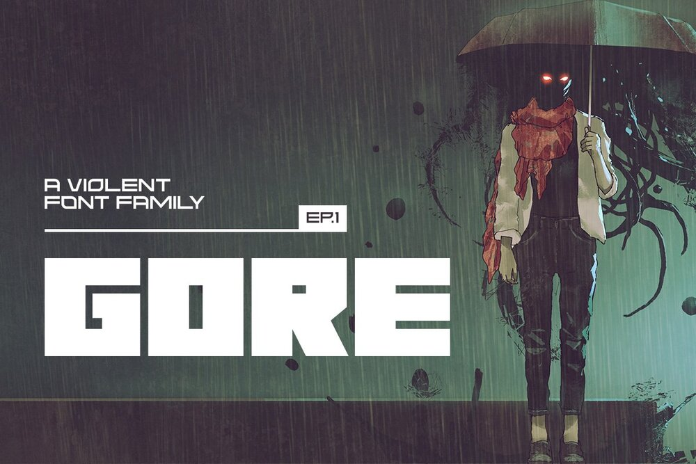

Tipografía para juegos oscuros y de terror, con letras gruesas sin curvas.

**Licencia:** de pago (15 $). [Ver Gore en Tugcu Design](https://www.tugcu.co/fonts/p/gore)

## 2. CageWorld

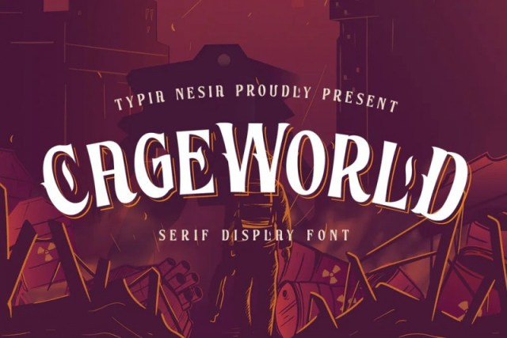

Serif de exhibición con remates afilados y aire de cartel antiguo. Encaja en juegos postapocalípticos, de fantasía oscura o del oeste.

**Licencia:** demo gratis para uso personal. [Ver CageWorld en ifonts](https://ifonts.xyz/cageworld-font.html)

## 3. Caveman

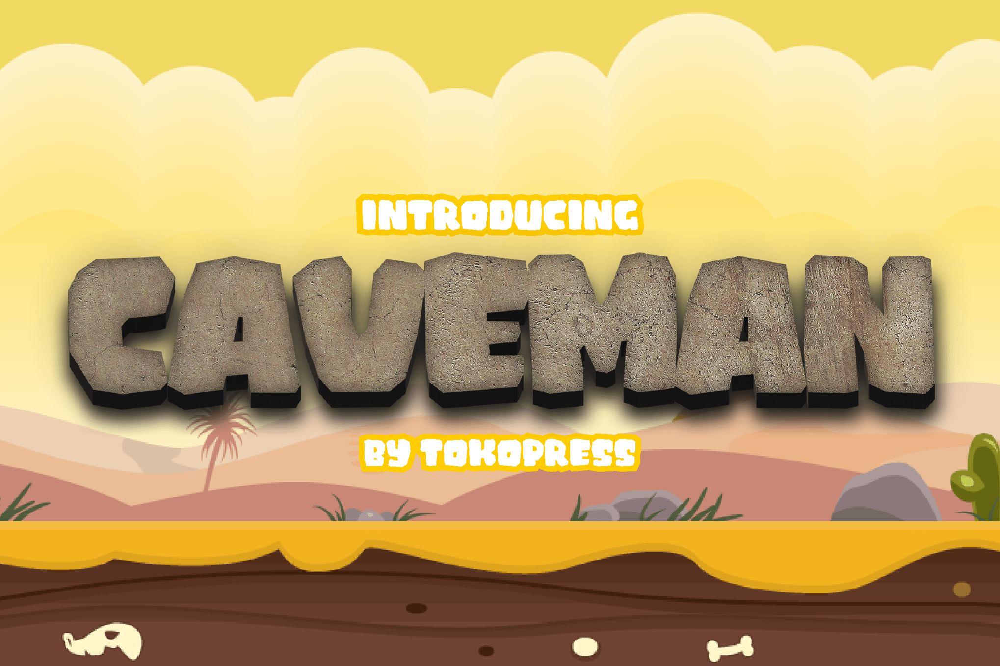

Diseñada para parecer tallada en piedra, perfecta para juegos de supervivencia y aventuras prehistóricas.

**Licencia:** incluida en la suscripción de Envato Elements. [Ver Caveman en Envato](https://elements.envato.com/caveman-gaming-font-W3R2EAM)

## 4. Dankosaurus

Tipografía inspirada en dinosaurios para juegos infantiles, disponible en estilos _regular_ y _redondeado_.

**Licencia:** gratis para uso personal. [Ver Dankosaurus en 1001 Fonts](https://www.1001fonts.com/dankosaurus-font.html)

## 5. Fun Blob

Letras blandas e irregulares, como de plastilina. Queda muy bien en títulos y botones de juegos casuales tipo cartoon.

**Licencia:** gratis para uso personal. [Ver Fun Blob en DaFont](https://www.dafont.com/fun-blob.font)

## 6. Game Over Brush SVG Font

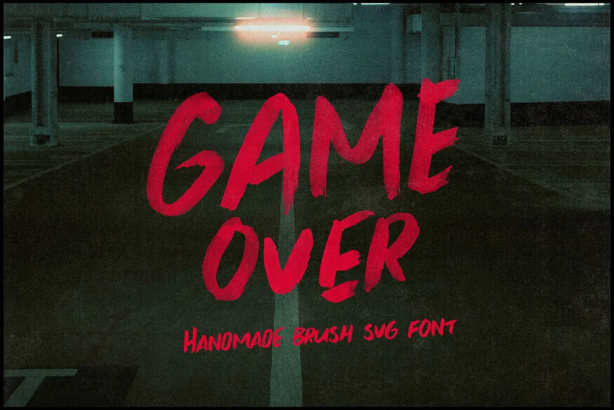

Fuente tipo pincel, ideal para juegos de terror y proyectos artísticos.

**Licencia:** de pago. [Ver Game Over Brush en YouWorkForThem](https://www.youworkforthem.com/font/T19474/game-over-brush-svg)

## 7. Arcadia

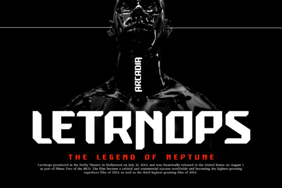

Tipografía moderna de ciencia ficción con diseño deportivo para logos de esports.

**Licencia:** de pago. [Ver Arcadia en Creative Fabrica](https://www.creativefabrica.com/es/product/arcadia/)

## 8. Grind Demolished

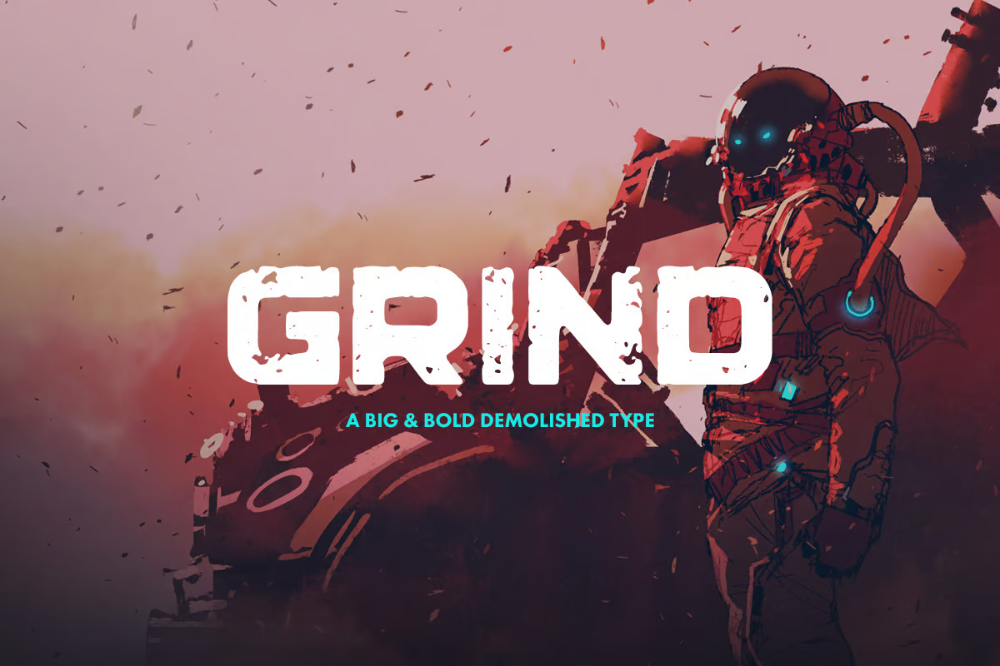

Grind es un tipo de letra grande y atrevida que transmite fuerza y dureza.

**Licencia:** incluida en la suscripción de Envato Elements. [Ver Grind Demolished en Envato](https://elements.envato.com/grind-demolished-Q6W5BGA)

## 9. GUMDROP

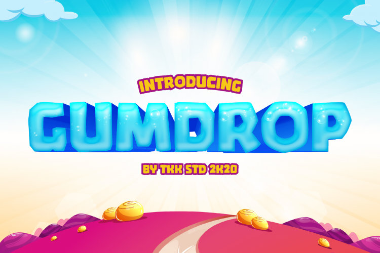

Letras en bloque, gruesas y brillantes, como gominolas. Pensada para títulos de juegos de puzles y móviles con estética de caramelo.

**Licencia:** gratis para uso personal; la comercial es de pago. [Ver GUMDROP en Just The Skills](https://justtheskills.com/product/gaming-font-gumdrop/)

## 10. Hermes

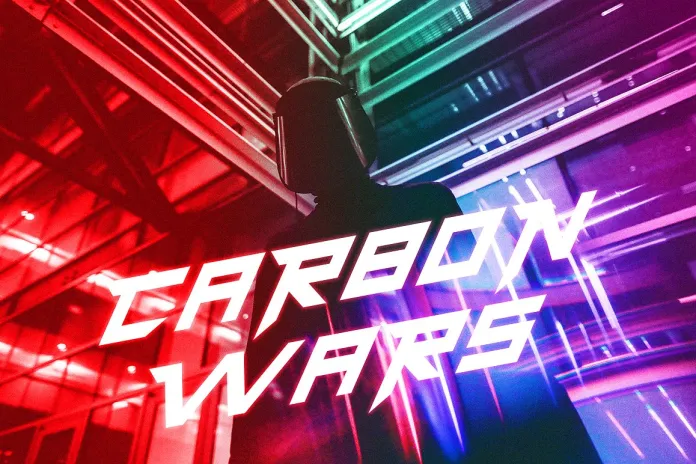

Tipografía moderna de estilo cyberpunk que combina lo retro y lo futurista.

**Licencia:** gratis para uso personal. [Ver Hermes en Befonts](https://befonts.com/hermes-typeface.html)

## 11. Monstarize

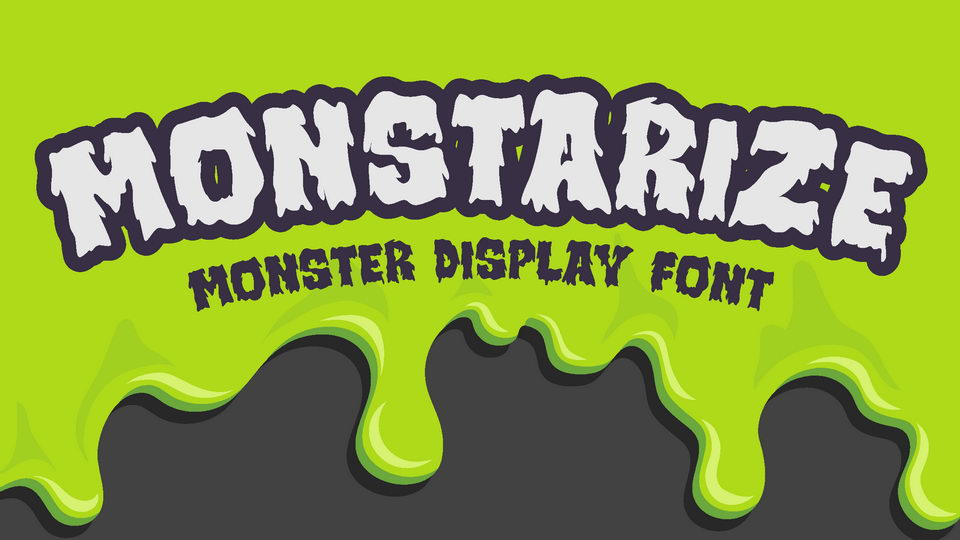

Tipografía de terror con letras que parecen gotear.

**Licencia:** gratis para uso personal. [Ver Monstarize en DaFont](https://www.dafont.com/monstarize.font)

## 12. Nordic Light

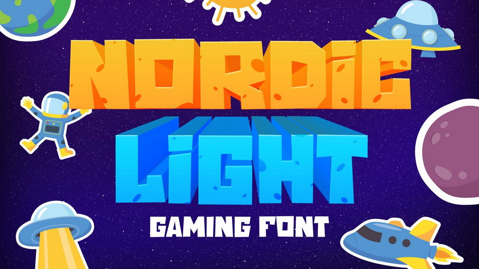

Fuente moderna con mezcla de esquinas cuadradas, ideal para títulos o pósteres.

**Licencia:** gratis para uso personal. [Ver Nordic Light en Fontesk](https://fontesk.com/nordic-light-font/)

## 13. Pixel Rand

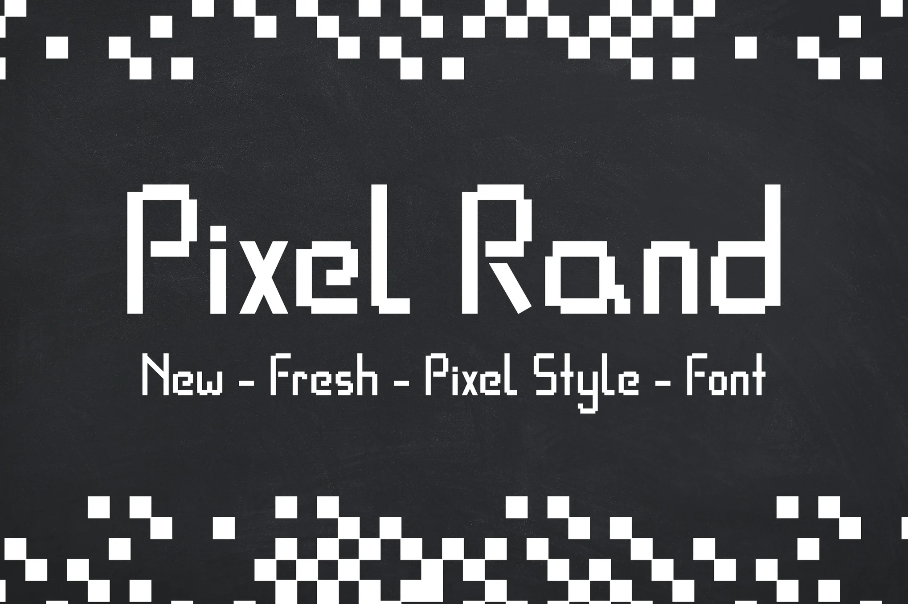

Píxeles en posiciones aleatorias: estilo moderno perfecto para videojuegos pixelados, vídeos y proyectos retro.

**Licencia:** incluida en la suscripción de Envato Elements. [Ver Pixel Rand en Envato](https://elements.envato.com/pixel-rand-B3AFEYM)

## 14. River Adventurer

Fuente sans-serif en mayúsculas que evoca aventuras en la jungla.

**Licencia:** gratis para uso personal. [Ver River Adventurer en 1001 Fonts](https://www.1001fonts.com/river-adventurer-font.html)

## 15. Rockgan Space Game

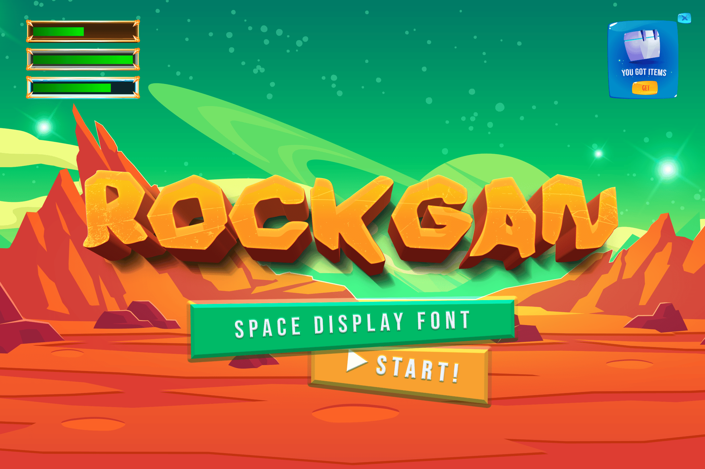

Fuente espacial con diseño juguetón para juegos móviles temáticos.

**Licencia:** incluida en la suscripción de Envato Elements. [Ver Rockgan en Envato](https://elements.envato.com/rockgan-space-game-display-font-HQ558Y6)

## 16. Royal Kingdom

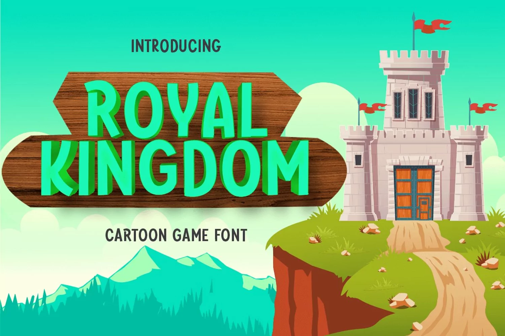

Fuente estilizada tipo cartoon, perfecta para interfaces de juegos y productos de merchandising.

**Licencia:** de pago. [Ver Royal Kingdom en Font Bundles](https://fontbundles.net/sensatype/2533167-royal-kingdom-cartoon-game-font)

## 17. Scrubland

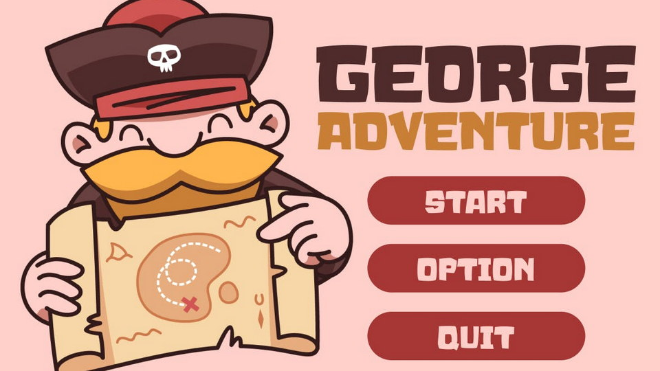

Tipografía moderna con un toque de naturaleza, ideal para juegos de aventura y exploración.

**Licencia:** gratis para uso personal. [Ver Scrubland en Fontesk](https://fontesk.com/scrubland-font/)

## 18. Victorious

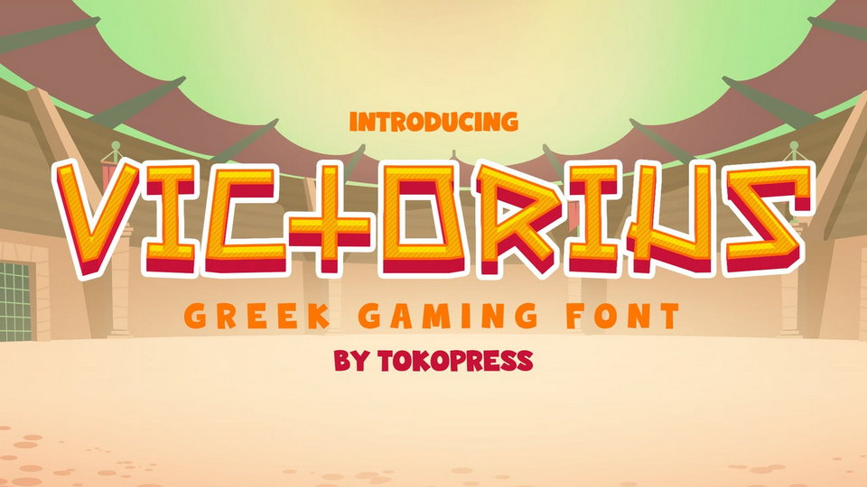

Diseño inspirado en textos griegos antiguos, ideal para juegos de gladiadores.

**Licencia:** gratis para uso personal. [Ver Victorious en Fontesk](https://fontesk.com/victorious-font/)

## 19. Tsuki

Tsuki es una fuente sans-serif inspirada en el manga y los videojuegos japoneses.

**Licencia:** de pago. [Ver Tsuki en Creative Fabrica](https://www.creativefabrica.com/product/tsuki/)

## 20. Guava Candy

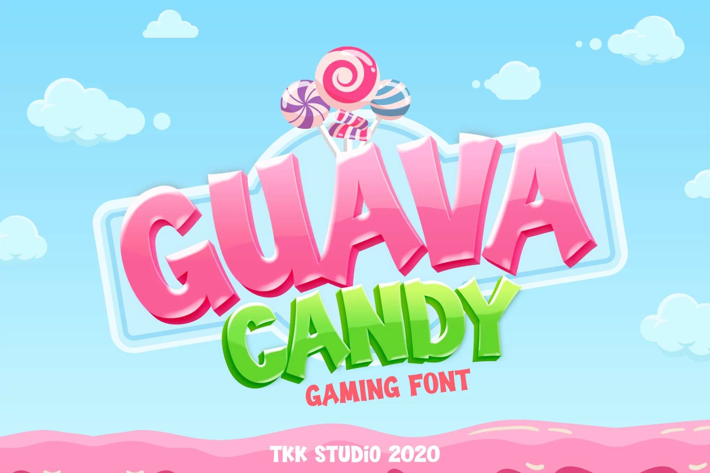

Guava Candy es una fuente en mayúsculas que transmite diversión y alegría.

**Licencia:** gratis para uso personal. [Ver Guava Candy en 1001 Fonts](https://www.1001fonts.com/guava-candy-font.html)

---

Antes de enamorarte de una, mira la licencia. "Gratis para uso personal" significa que no puedes usarla en un juego que vendas o publiques con anuncios sin comprar la licencia comercial.

¿Echas en falta alguna fuente en la lista? Déjala en los comentarios.
