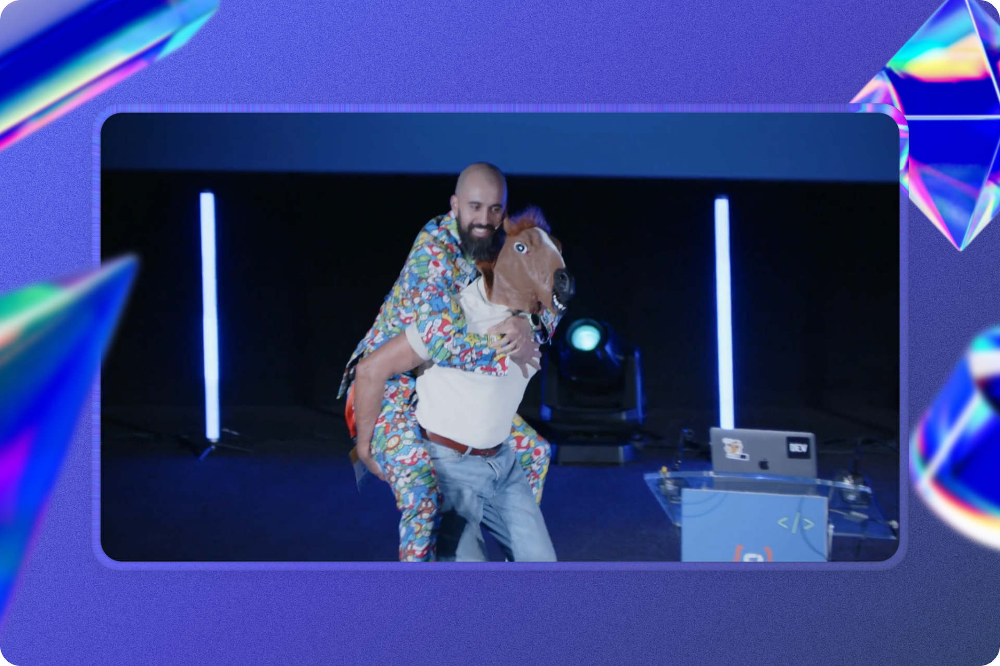
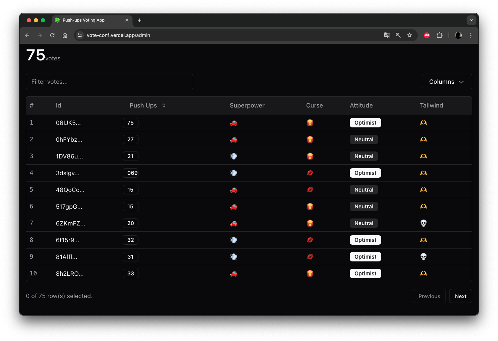

Dar charlas como developer te trae oportunidades laborales, contactos y confianza, y te obliga a entender de verdad lo que explicas. Para preparar una buena charla técnica, piensa en tu público, define qué quieres que se lleve, cuéntalo como una historia y ensaya mucho más de lo que crees necesario.

Hablar en público impone. Pero evitarlo también tiene un coste: oportunidades que no llegan y una carrera que avanza menos de lo que podría.

Lo digo por experiencia: desde 2017 he dado charlas en conferencias y meetups, y he participado en podcasts y entrevistas. Puedes verlas todas en [mi página de charlas](/talks/). Cada una me ha obligado a explicar mejor lo técnico, y en nuestra industria eso está muy valorado.

En este artículo te cuento qué beneficios trae hablar en público y cómo preparar tu charla.

> Dar una charla técnica no tiene por qué ser aburrido: a veces hay caballos y trajes de Super Mario 🍄🎤

## Por qué hablar en público ayuda a un developer

¿Crees que saber hablar bien en público es solo cosa de managers o la gente de ventas? **Error**. Como software engineer, mejorar tu oratoria o dar charlas puede darle un giro brutal a tu carrera.

No hablo solo de **oportunidades laborales** (que también, y esto lo digo por experiencia propia), sino de crecimiento personal. Te cambia la forma en la que te relacionas con otros humanos: de repente quieren charlar contigo, colaborar en proyectos o directamente trabajar a tu lado.

Es como desbloquear un superpoder que casi nadie se molesta en entrenar. Y justo por eso marca tanta diferencia.

### Crecimiento profesional: más allá del código

Saber programar es la base, pero lo que te diferencia es cómo comunicas tus ideas. Un developer que se expresa bien destaca.

- **Amplía tu red**. Hablar en público te conecta con posibles colaboradores, mentores y empleadores.
- **Posiciona tu experiencia**. Dar charlas muestra lo que sabes y te convierte en referente en tu área.
- **Mejora el trabajo en equipo**. Explicar ideas complejas con claridad reduce malentendidos y facilita el liderazgo.

Hablar en público no es solo una _soft skill_: es una ventaja competitiva que el código, por sí solo, no te va a dar.

### Desarrollo personal: confianza++

Mejorar tu comunicación también te hace crecer como persona.

- **Más confianza**. Con cada charla bajan los nervios y sube tu seguridad.
- **Comunicación más clara**. Aprendes a traducir lo técnico en ideas accesibles para cualquier contexto.
- **Aprendizaje constante**. Preparar charlas te obliga a investigar, ordenar ideas y mantenerte al día.

#### PRO TIP 😉

No empieces a lo grande. Hazlo en pequeño: una demo en tu equipo, una daily bien llevada o un meetup corto. La confianza se construye charla a charla.

Si te quedas con una idea, que sea esta: hablar en público no es un extra, es una palanca real para crecer como developer. Vamos ahora con cómo prepararte para hacerlo bien.

## Cómo prepararse eficazmente para una charla técnica

Vale, ya vimos por qué dar charlas merece la pena. Ahora viene lo importante: cómo preparar una charla técnica que se entienda, enganche y no se haga pesada.

### Conoce a tu público

Antes de abrir las diapositivas, define para quién hablas. Si tu audiencia es técnica, puedes profundizar sin miedo.

Si vas a hablar con managers o perfiles menos técnicos, simplifica el lenguaje y usa ejemplos más cercanos al negocio. La clave es que te entiendan.

### Define objetivos claros

Antes de preparar slides, responde esto: **¿qué quiero que la gente se lleve de esta charla?**

Puede ser aprender una tecnología, evitar un error común o entender cómo resolviste un problema real. Si defines ese objetivo desde el inicio, todo lo demás se ordena solo.

### Estructura tu presentación

Piensa tu charla como una historia en tres actos:

1. **Introducción**: Presenta el tema y lo que la audiencia puede esperar.
2. **Cuerpo**: Divide el contenido en secciones lógicas. Usa ejemplos y casos prácticos para ilustrar puntos clave. No te olvides de los memes.
3. **Conclusión**: Resume los puntos principales y ofrece un llamado a la acción o preguntas para reflexionar.

### Desarrolla visuales atractivos

Las slides están para reforzar tu mensaje, no para reemplazarte. Si las haces bien, la gente te sigue mejor y recuerda más.

* **Poco texto**: Frases cortas, ideas claras. Nada de párrafos.
* **Consistencia visual**: Mantén tipografía, colores y estilo en toda la presentación.
* **Contraste y legibilidad**: Si no se lee al fondo de la sala, no sirve.
* **Visuales con intención**: Usa imágenes o gráficos que expliquen algo, no solo que decoren.
* **Humor con criterio**: Un meme bien puesto despierta a la audiencia.
* **Una idea por slide**: Mejor varias slides limpias que una diapositiva saturada.

### Incorpora narrativa

Una charla técnica sin narrativa se siente como documentación leída en voz alta. Si armas un hilo, la gente conecta y entiende mejor.

Por ejemplo, en mi charla [**JavaScript, make TikTok great again**](/talks/javascript-make-tiktok-great-again-t3chfest/) arranco con el gancho de "salvar TikTok del ban en EE. UU." y desde ahí aterrizo cómo funciona JavaScript en el navegador. Primero captas la atención, luego profundizas en lo técnico.

### Practicando tu presentación: desde casa hasta el escenario

> TL;DR: practica, practica, practica, practica, practica y practica.

#### Ensaya absolutamente todo

La diferencia entre una charla floja y una charla sólida suele estar en el ensayo. Practica varias veces como si ya estuvieras en el escenario y fíjate en:

- **Tiempo**: Asegúrate de no pasarte del tiempo asignado.
- **Claridad**: Articula bien y modula la voz para mantener la atención.
- **Pausas**: Usa pausas para enfatizar puntos clave y dar tiempo a la audiencia para procesar la información.
- **Lenguaje corporal**: Usa gestos y movimiento para enfatizar puntos. Nada de manos en los bolsillos.
- **Feedback**: Practica frente a amigos o compañeros para recibir feedback real.

Repite la charla completa hasta que te salga natural. Sí, al principio se siente raro hablarle al espejo, al perro o grabarte. Hazlo igual. No existe el "_he practicado demasiado_" cuando quieres dar una buena charla. Ese concepto no existe.

### Prepárate para aspectos técnicos

Antes de subir al escenario, haz un checklist técnico:

* **Diapositivas**: Lleva una versión offline por si te quedas sin WiFi.
* **Conexiones**: Lleva cables, adaptadores y lo que necesites para tu portátil.
* **Audio/Visual**: Revisa con el equipo técnico micro, pantalla y sonido.
* **Plan B**: Si la demo falla, tira de un vídeo pregrabado o capturas.

### Interactúa con la audiencia

Mantén contacto visual y sé receptivo a las señales de la audiencia. Fomentar preguntas o discusiones puede crear una sesión más interactiva y atractiva.

En mi caso, suelo preparar una app de votos o encuestas rápidas para que la gente participe en vivo. Con las herramientas de _vibe coding_, hoy montarlo es mucho más fácil.

Si quieres saber más sobre oratoria, mira el vídeo "9 Habits for Clearer Speaking" de _Vinh Giang_ (me encanta este tío):

## Networking

Dar una charla no termina cuando bajas del escenario.

Ahí empieza el networking de verdad: gente que conecta contigo por lo que acabas de compartir.

No tienes que forzar conversaciones ni perseguir a nadie. Compartes algo útil, alguien piensa "_esta persona sabe de esto_" y se acerca en el descanso. Conexión natural.

## Dónde dar tu primera charla

No necesitas una conferencia grande para empezar. De menos a más:

1. **Una charla interna en tu empresa.** El público te conoce y el ambiente es seguro.
2. **Un meetup local.** Casi todos buscan ponentes, y muchos aceptan charlas cortas de 10 o 15 minutos.
3. **Una _lightning talk_.** Cinco minutos sobre una sola idea. Es la mejor forma de perder el miedo.
4. **El CFP de una conferencia.** Cuando ya te sientas cómodo, presenta tu propuesta al _call for papers_ (CFP). Una charla que ya has dado en un meetup es una gran candidata.

## Conclusión

Dar charlas como developer no va solo de hablar bien. Va de aprender mejor, comunicar con claridad y generar impacto con lo que sabes.

Además, cada charla te pone delante de gente con tus mismos intereses, y de ahí salen colaboraciones, amistades y, a veces, trabajos.

Si estás empezando, no busques perfección: elige un tema que te guste, prepara una versión corta y pruébala en un entorno pequeño. A partir de ahí, itera con feedback y vuelve a subirte al escenario.

### Recurso final (muy recomendado)

Si quieres cerrar este artículo con una idea práctica y aplicable desde hoy, el vídeo "4 Tips To Improve Your Public Speaking" de Motivation2Study merece muchísimo la pena:

Si tienes algún recurso que te haya ayudado con la oratoria, compártelo en los comentarios.
