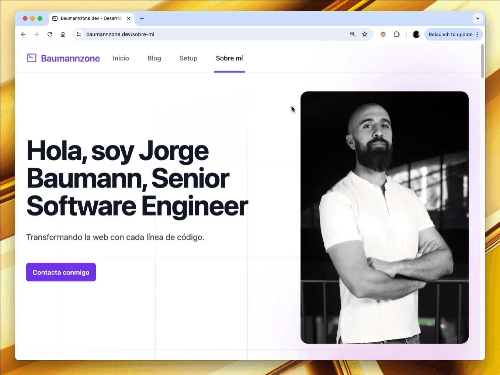

Para saber qué elemento tiene el foco en tiempo real, crea una _live expression_ con `document.activeElement` en la consola de las DevTools de Chrome o Edge. Se actualiza sola mientras navegas con el ratón o con `Tab`. En Firefox y Safari, o desde tu propio código, puedes conseguir lo mismo con el evento `focusin`.

Es muy útil para probar la accesibilidad de una web: comprobar que la navegación con teclado sigue un orden lógico, encontrar elementos que reciben el foco sin que se note o ver si un modal deja escapar el foco.

## Cómo hacerlo con las live expressions de Chrome

Las _live expressions_ son expresiones que se quedan fijadas encima de la consola y se vuelven a evaluar cada 250 milisegundos. Están en Chrome y en Edge, pero no en Firefox ni en Safari.

1. Abre las DevTools en la pestaña **Console**. Puedes usar `F12`, `Cmd` + `Option` + `J` en macOS o `Ctrl` + `Shift` + `J` en Windows y Linux.
2. En la parte superior verás un botón con un icono en forma de ojo (**Create live expression**). Haz clic en él.
3. En el cuadro de texto que aparece, escribe `document.activeElement`. Esta propiedad devuelve el elemento del DOM que tiene el foco en ese momento.
4. Navega por la página haciendo clic o usando la tecla `Tab`. La expresión se actualizará automáticamente con el elemento que tiene el foco.



Si pasas el ratón por encima del resultado, Chrome resalta el elemento en la página, igual que en el panel **Elements**.

## Cómo hacerlo con JavaScript: el evento `focusin`

Si usas Firefox o Safari, o si quieres hacerlo desde tu propio código, no hace falta comprobar el foco en bucle. El evento `focusin` salta cada vez que un elemento recibe el foco y, a diferencia de `focus`, se propaga hacia arriba, así que basta con escucharlo en `document`:

```javascript
document.addEventListener("focusin", (event) => {
  console.log("Foco en:", event.target);
});
```

Pégalo en la consola y navega con `Tab`: verás en la consola cada elemento que recibe el foco.

## Cuidado con el Shadow DOM

Si el foco está dentro de un web component, `document.activeElement` no devuelve el elemento real, sino el componente que lo contiene. Para llegar al elemento de verdad, hay que bajar por cada `shadowRoot`:

```javascript
function getDeepActiveElement() {
  let element = document.activeElement;

  while (element?.shadowRoot?.activeElement) {
    element = element.shadowRoot.activeElement;
  }

  return element;
}
```

Solo funciona con Shadow DOM abierto (`mode: "open"`); con uno cerrado, `shadowRoot` es `null`.

Una _live expression_ admite una expresión, no una función con nombre, pero puedes envolver el mismo código en una [IIFE](/blog/que-son-las-iife-en-javascript-y-como-funcionan/):

```javascript
(() => {
  let element = document.activeElement;
  while (element?.shadowRoot?.activeElement) {
    element = element.shadowRoot.activeElement;
  }
  return element;
})();
```

## Cómo verlo a simple vista con CSS

Si no quieres abrir las DevTools, añade temporalmente esta regla a tu CSS:

```css
*:focus {
  outline: 2px solid red !important;
}
```

Cualquier elemento con el foco tendrá un borde rojo. Si con esta regla hay momentos en los que pulsas `Tab` y no ves ningún borde, el foco está en un elemento oculto o fuera de la pantalla.

## Conclusión

Con `document.activeElement` en una _live expression_ ves en tiempo real qué elemento tiene el foco mientras interactúas con tu web. Y si no estás en Chrome, `focusin` o una regla de CSS te dan la misma información.

Si estás revisando la accesibilidad de tus componentes, prueba con los [acordeones nativos con `<details>` y `<summary>`](/blog/acordeones-nativos-en-html-sin-una-linea-de-javascript/): verás cómo el foco pasa por cada `<summary>`.

¿Qué otros casos de uso conoces para las _live expressions_? ¡Déjame un comentario abajo!

## Fuentes

- [Watch JavaScript values in real time with Live Expressions](https://developer.chrome.com/docs/devtools/console/live-expressions), en la documentación de Chrome DevTools.
- [`Document.activeElement`](https://developer.mozilla.org/en-US/docs/Web/API/Document/activeElement) y [`ShadowRoot.activeElement`](https://developer.mozilla.org/en-US/docs/Web/API/ShadowRoot/activeElement), en MDN.
- [El evento `focusin`](https://developer.mozilla.org/en-US/docs/Web/API/Element/focusin_event), en MDN.
