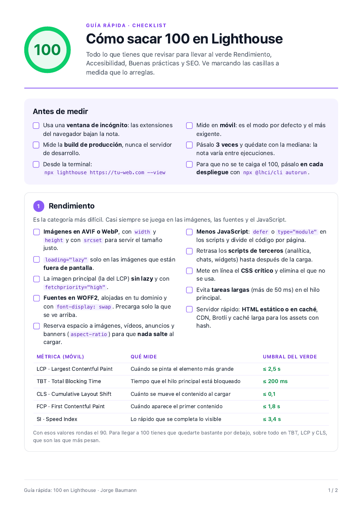

Para sacar 100 en Lighthouse tienes que llevar al verde sus cuatro categorías con nota: **Rendimiento**, **Accesibilidad**, **Buenas prácticas** y **SEO**. Casi todo se reduce a imágenes bien servidas, poco JavaScript, HTML semántico y un `<head>` completo. Lo he resumido en una checklist de dos páginas en PDF que puedes descargar gratis, imprimir e ir marcando.

  <a href="/guias/guia-lighthouse-100.pdf" download class="inline-flex items-center gap-2 rounded-lg bg-violet-600 px-5 py-3 font-semibold text-white hover:bg-violet-700 focus-visible:outline focus-visible:outline-2 focus-visible:outline-offset-2 focus-visible:outline-violet-600">
    <svg aria-hidden="true" class="h-5 w-5" fill="none" viewBox="0 0 24 24" stroke="currentColor" stroke-width="2"><path stroke-linecap="round" stroke-linejoin="round" d="M12 4v12m0 0l-5-5m5 5l5-5M5 20h14"/></svg>
    Descargar la guía (PDF, 380 KB)
  </a>

No hace falta registrarse ni dejar el correo: el enlace descarga el archivo directamente.

## ¿Qué incluye la guía?

- **Antes de medir**: cómo pasar Lighthouse para que la nota no te engañe.
- **Rendimiento**: imágenes, fuentes, JavaScript, CSS y servidor, con una tabla de las métricas y el valor a partir del cual se ponen en verde.
- **Accesibilidad**: contraste, textos alternativos, etiquetas, encabezados y zonas táctiles.
- **Buenas prácticas**: HTTPS, consola sin errores, permisos y cabeceras de seguridad.
- **SEO**: título, descripción, canonical, `robots.txt` y enlaces rastreables.
- **El `<head>` mínimo** de cualquier página, listo para copiar.
- **Un extra sobre Agentic Browsing**, la categoría experimental que Lighthouse 13.3 añadió para medir si los agentes de IA pueden usar tu web.

## ¿Por qué Rendimiento es la más difícil?

Accesibilidad, Buenas prácticas y SEO son casi todo listas de comprobación: o cumples cada punto o no. Si los cumples todos, tienes el 100.

Rendimiento es distinto. La nota sale de cinco métricas medidas en una simulación de un móvil de gama media con una conexión lenta, y cada una puntúa según lo lejos que quedes de unos valores de referencia. Por eso una web que va rápida en tu portátil puede sacar un 70.

Las que más pesan son **TBT** (cuánto tiempo está bloqueado el hilo principal), **LCP** (cuándo se pinta el elemento más grande) y **CLS** (cuánto se mueve el contenido al cargar). Entre las tres suman el 80 % de la nota.

Y cuanto más alta es la nota, más cuesta subirla. Un LCP de 2,5 segundos te da un 90 en esa métrica, pero para el 99 tienes que bajar a unos 1,2 segundos, que es lo que consiguen las webs más rápidas. Si vas justo de tiempo, empieza por la imagen principal de la página y por los scripts de terceros: son los dos culpables más habituales.

## ¿Basta con sacar 100?

No del todo. Lighthouse mide en un entorno de laboratorio, una sola carga y en condiciones simuladas. Lo que Google usa para posicionar son las Core Web Vitals de usuarios reales, que puedes ver en PageSpeed Insights o en Search Console.

Con la accesibilidad pasa algo parecido: Lighthouse solo detecta una parte de los problemas. Un 100 significa que no ha encontrado errores automáticos, no que tu web sea accesible. Pruébala también con teclado y con un lector de pantalla.

Aun así, el 100 es un buen punto de partida: si lo tienes, has resuelto lo básico y lo que queda ya es afinar.

## Fuentes

- [Lighthouse performance scoring](https://developer.chrome.com/docs/lighthouse/performance/performance-scoring), en Chrome for Developers.
- [Agentic Browsing scoring](https://developer.chrome.com/docs/lighthouse/agentic-browsing/scoring), en Chrome for Developers.
- [Lighthouse CI](https://github.com/GoogleChrome/lighthouse-ci), en GitHub.
