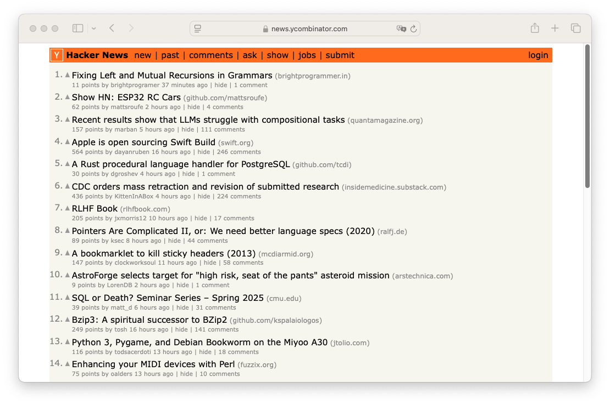
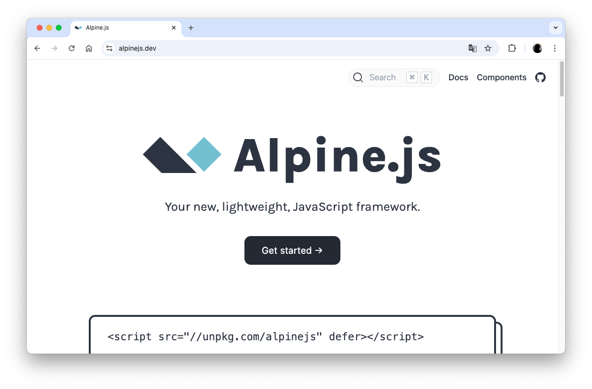
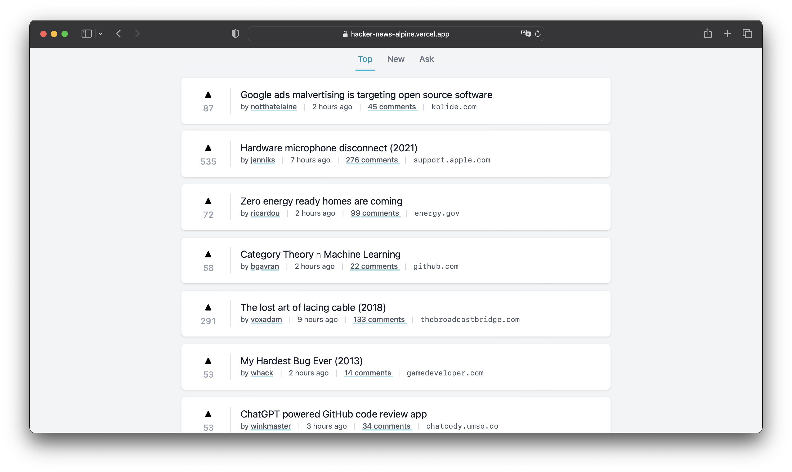

Para hacer un clon de **Hacker News** no necesitas React ni un paso de build complicado. El mío es una página HTML con **Alpine.js** cargado desde un CDN para la interactividad, **Tailwind CSS** para los estilos y la API de HNPWA para las noticias. Te cuento cómo está hecho.

## Introducción

En 2023 decidí crear un clon de Hacker News, la famosa plataforma de noticias y discusión sobre tecnología. Mi objetivo era hacerlo simple, minimalista y funcional, utilizando herramientas modernas pero ligeras. Para ello, elegí dos tecnologías que me encantan: Alpine.js (la versión 3.12) y Tailwind CSS (la versión 3).

## ¿Qué es Hacker News?

[Hacker News](https://news.ycombinator.com/) es una página web de noticias y discusión de tecnología. La creó Paul Graham, de Y Combinator, en 2007, y es una de las comunidades tecnológicas más populares de la red. En ella se publican noticias sobre tecnología, programación, ciencia, etc. y se pueden comentar y votar.



## Alpine.js

[Alpine.js](https://alpinejs.dev/) es un framework de JavaScript muy ligero para añadir interactividad directamente en tu HTML. En lugar de escribir componentes en archivos aparte, escribes el estado y la lógica en atributos como `x-data`, `x-for` o `x-text`. Sigues escribiendo JavaScript, pero dentro del propio HTML y sin paso de build.

No es una alternativa a React, Vue o Angular para cualquier proyecto, pero para una página como esta es más que suficiente. Su sintaxis es muy similar a la de Vue.js, por lo que si ya lo conoces, aprenderás Alpine.js en muy poco tiempo.



## Tailwind CSS

[Tailwind CSS](https://tailwindcss.com/) es un framework de CSS _utility-first_ que te permite construir interfaces directamente en tu HTML, solo con clases de CSS. Con Tailwind, puedes crear diseños complejos sin escribir CSS personalizado, lo que acelera mucho el desarrollo.

En este proyecto, el único paso de build es el CLI de Tailwind, que genera el CSS final con las clases que uso.

## El proyecto: un clon de Hacker News

El proyecto es open source y puedes ver el código en GitHub: [baumannzone/hacker-news-alpine](https://github.com/baumannzone/hacker-news-alpine).



### La API: por qué no uso la oficial

La [API oficial de Hacker News](https://github.com/HackerNews/API) devuelve solo una lista de IDs. Para pintar la portada tendrías que hacer una petición por cada noticia, unas 30 por página.

Por eso uso la [API de HNPWA](https://github.com/tastejs/hacker-news-pwas/blob/master/docs/api.md), una API no oficial pensada justo para proyectos como este. Con una sola petición devuelve las 30 noticias de una página, con su título, puntos, autor, comentarios y dominio.

### Características principales

- **Interfaz minimalista y moderna**: el sitio web original de Hacker News se ve bastante anticuado, así que decidí darle un toque más moderno y minimalista.
- **Responsive**: funciona en móvil y en escritorio.
- **Secciones**: top, new, ask, show y jobs, como el original.
- **Paginación**: muestra las noticias en páginas de 30 en 30.
- **Comentarios**: si haces clic en una noticia, se abre en una pestaña nueva; si haces clic en los comentarios, navegas a la página de comentarios dentro de la aplicación.

### Tecnologías utilizadas

- Alpine.js, cargado desde un CDN.
- Tailwind CSS.
- Vercel, para el despliegue y el [hosting](https://hacker-news-alpine.vercel.app/).
- La API de HNPWA, para obtener las noticias.

## Cómo funciona

### Pedir las noticias

Toda la comunicación con la API está en una función. Recibe la sección y la página, y devuelve el array de noticias:

```javascript
const BASE_URL = "https://api.hnpwa.com/v0";

const SECTIONS = {
  top: "/news",
  new: "/newest",
  ask: "/ask",
  show: "/show",
  jobs: "/jobs",
};

const getItems = async (section, page = 1) => {
  try {
    const res = await fetch(`${BASE_URL}${SECTIONS[section]}/${page}.json`);
    return await res.json();
  } catch (err) {
    console.error(err);
  }
};
```

### Pintar la lista con Alpine.js

En el HTML, `x-data` declara el estado, `x-init` pide las noticias al cargar y `x-for` pinta una tarjeta por noticia:

```html
<section
  x-data="{ items: [] }"
  x-init="items = await getItems(currentSection, $store.pagination.currentPage)"
>
  <ul role="list" class="space-y-3">
    <template x-for="item in items" :key="item.id">
      <li class="flex bg-white px-4 py-4 shadow rounded-md">
        <span x-text="item.points" class="text-gray-400 text-sm"></span>
        <a :href="item.url" x-text="item.title" class="text-gray-900"></a>
      </li>
    </template>
  </ul>
</section>
```

### La paginación

La página actual vive en un _store_ global de Alpine, así que cualquier parte de la página puede leerla o cambiarla:

```javascript
document.addEventListener("alpine:init", () => {
  Alpine.store("pagination", {
    currentPage: 1,
    nextPage() {
      this.currentPage++;
    },
    previousPage() {
      this.currentPage--;
    },
  });
});
```

Con `$watch('$store.pagination.currentPage', ...)` la lista vuelve a pedir las noticias cada vez que cambia la página.

## Conclusión

Hacía tiempo que quería crear un clon de Hacker News, ¡y por fin lo hice! Si quieres crear algo rápido, minimalista y sin montar un proyecto entero, **Alpine.js** y **Tailwind CSS** son un buen combo. Este clon es la prueba: un par de archivos HTML, un archivo de JavaScript con las funciones para pedir los datos y poco más.

¿Te animas a probarlo? Clona [el repositorio](https://github.com/baumannzone/hacker-news-alpine) o échale un vistazo a [la versión en vivo](https://hacker-news-alpine.vercel.app/).

👉 ¿Te gustó? 🤩 ¡Dame una estrellita en GitHub!

## Fuentes

- [Documentación de Alpine.js](https://alpinejs.dev/start-here).
- [La API de HNPWA](https://github.com/tastejs/hacker-news-pwas/blob/master/docs/api.md), en el repositorio de tastejs.
- [La API oficial de Hacker News](https://github.com/HackerNews/API), en GitHub.
