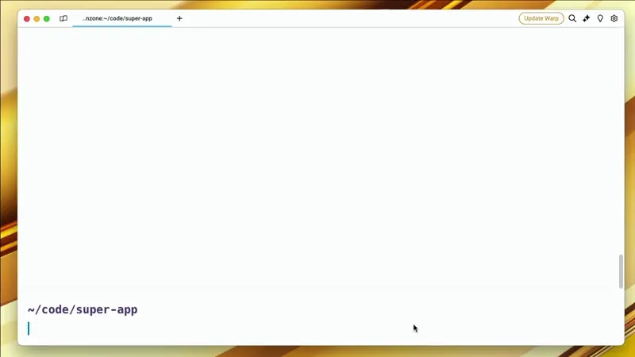
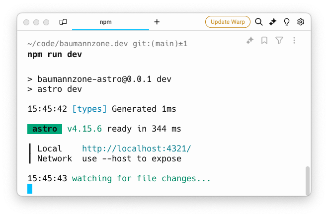

El `package.json` es el archivo JSON que hay en la raíz de cualquier proyecto de JavaScript o Node.js y que describe ese proyecto: cómo se llama, qué versión es, qué dependencias necesita y qué comandos (_scripts_) se pueden ejecutar. Lo leen npm, pnpm, Yarn y Bun para saber qué instalar, y el propio Node.js para saber cómo cargar tu código.

Piensa en `package.json` como el corazón de tu proyecto. Es donde guardas toda la info importante: qué hace tu proyecto, qué versión es, qué librerías necesita para funcionar... básicamente, es el manual de instrucciones de tu aplicación.

## Inicializar un proyecto

¿Recuerdas la primera vez que escribiste "_Hola Mundo_" en programación? Bueno, crear tu primer `package.json` es casi igual de aburrido. Solo tienes que abrir tu terminal y escribir:

```bash
npm init
```



`npm` te hará un montón de preguntas, como si estuvieras en una cita rápida con tu proyecto. Si no sabes qué responder, puedes usar el flag `-y` para que `npm` rellene automáticamente todas las respuestas por ti:

```bash
npm init -y
```

_¡Boom!_ Tienes un `package.json` instantáneo con los valores predeterminados.

```json
{
  "name": "super-app",
  "version": "1.0.0",
  "description": "",
  "main": "index.js",
  "scripts": {
    "test": "echo \"Error: no test specified\" && exit 1"
  },
  "keywords": [],
  "author": "",
  "license": "ISC",
  "type": "commonjs"
}
```

El campo `name` sale del nombre de la carpeta en la que estás. La última línea, `"type": "commonjs"`, la añaden las versiones recientes de npm; si usas una más antigua no la verás.

## Partes de un `package.json`

Ahora, echemos un vistazo a las partes más interesantes de un `package.json`:

- `name` y `version`: Es como el nombre y apellido de tu proyecto.

```json
{
  "name": "mi-super-app",
  "version": "1.0.0"
}
```

El nombre de tu proyecto debe ser único, ya que (si lo publicas) se usa para identificar tu proyecto en el registro de paquetes de npm. Tiene que ir en minúsculas, sin espacios y con un máximo de 214 caracteres.

La versión sigue el formato de _SemVer_ (Semantic Versioning), que consta de tres números: `MAJOR.MINOR.PATCH`.

| Número  | Cuándo se sube                                      | Ejemplo           |
| :------ | :-------------------------------------------------- | :---------------- |
| `MAJOR` | Cambios que rompen la compatibilidad                | `1.4.2` → `2.0.0` |
| `MINOR` | Funcionalidad nueva que no rompe nada               | `1.4.2` → `1.5.0` |
| `PATCH` | Corrección de errores                               | `1.4.2` → `1.4.3` |

- `scripts`: Aquí es donde la magia sucede. Puedes crear atajos para comandos que usas frecuentemente.

```json
{
  "scripts": {
    "dev": "astro dev",
    "start": "astro dev",
    "build": "astro build"
  }
}
```

Este es un ejemplo del bloque `scripts` de un `package.json` de un proyecto Astro.

Para ejecutar un script, solo tienes que escribir `npm run` seguido del nombre del script:

```bash
npm run dev
```



Hay dos scripts con atajo propio: `npm start` y `npm test` funcionan sin el `run`.

- `dependencies` y `devDependencies`: Aquí es donde guardas las librerías que necesita tu proyecto para funcionar. La diferencia entre ambas es que `dependencies` son las librerías que necesita tu proyecto en producción, mientras que `devDependencies` son las librerías que solo necesitas en desarrollo.

```json
{
  "dependencies": {
    "express": "^5.0.0",
    "react": "^18.3.1"
  },
  "devDependencies": {
    "vitest": "^2.1.1"
  }
}
```

No hace falta que las escribas a mano: `npm install express` añade el paquete a `dependencies`, y `npm install -D vitest` lo añade a `devDependencies`.

Las versiones de las librerías siguen el formato de _SemVer_, pero puedes usar caracteres especiales como `^`, `~` o `*` para especificar rangos de versiones:

| Rango    | Qué versiones acepta                           | Equivale a          |
| :------- | :--------------------------------------------- | :------------------ |
| `1.2.3`  | Solo esa versión exacta                        | `1.2.3`             |
| `~1.2.3` | Solo parches nuevos                            | `>=1.2.3 <1.3.0`    |
| `^1.2.3` | Parches y versiones menores nuevas             | `>=1.2.3 <2.0.0`    |
| `^0.2.3` | Por debajo de la `1.0.0`, solo parches         | `>=0.2.3 <0.3.0`    |
| `*`      | Cualquier versión                              | `>=0.0.0`           |

El `^` es lo que pone npm por defecto cuando instalas un paquete. La versión exacta que acaba instalada no se guarda en el `package.json`, sino en el archivo de bloqueo (`package-lock.json` en el caso de npm), que es el que garantiza que todo el equipo instala lo mismo.

- `keywords`: Aquí puedes añadir palabras clave que describan tu proyecto. Esto es útil para que otros desarrolladores puedan encontrar tu proyecto más fácilmente. Si no vas a publicar tu proyecto en npm, puedes ignorar esta propiedad.

```json
{
  "keywords": ["metaverse", "css-in-js", "3d"]
}
```

- `license`: Aquí puedes especificar bajo qué licencia se distribuye tu proyecto. Si no estás seguro de qué licencia usar, puedes elegir una de las licencias más populares, como MIT.

```json
{
  "license": "MIT"
}
```

- `repository`: Aquí puedes especificar la URL de tu repositorio de código. No es obligatorio, pero es útil si quieres que otros desarrolladores puedan encontrar tu código fuente.

```json
{
  "repository": {
    "type": "git",
    "url": "https://github.com/baumannzone/mi-super-app"
  }
}
```

## Ejemplo completo

Este es un ejemplo completo del `package.json` de esta web que estás leyendo ahora mismo, que es un proyecto Astro:

```json
{
  "name": "baumannzone-astro",
  "type": "module",
  "version": "0.0.1",
  "scripts": {
    "dev": "astro dev",
    "start": "astro dev",
    "build": "astro build",
    "preview": "astro preview",
    "astro": "astro"
  },
  "dependencies": {
    "@astrojs/mdx": "^7.0.2",
    "@astrojs/rss": "^4.0.19",
    "@astrojs/sitemap": "^3.7.3",
    "@astrojs/tailwind": "^6.0.2",
    "@tailwindcss/typography": "^0.5.13",
    "astro": "^7.0.7",
    "matter-js": "^0.20.0",
    "tailwindcss": "^3.4.3"
  },
  "devDependencies": {
    "sharp": "^0.33.4"
  }
}
```

Aquí puedes ver las dependencias que usa este proyecto y qué versiones se están utilizando.

---

## Otras propiedades que te vas a encontrar

Existen muchas más propiedades que puedes añadir a tu `package.json`. Estas no son imprescindibles para empezar, pero aparecen en casi cualquier proyecto real:

| Propiedad          | Para qué sirve                                                                              |
| :----------------- | :------------------------------------------------------------------------------------------ |
| `type`             | Indica si los archivos `.js` son módulos ES (`"module"`) o CommonJS (`"commonjs"`)          |
| `main` y `exports` | El punto de entrada del paquete. `exports` es la forma moderna y permite varias entradas    |
| `private`          | Con `true`, npm se niega a publicar el paquete. Útil en aplicaciones que no son librerías   |
| `engines`          | Qué versiones de Node.js admite el proyecto                                                 |
| `peerDependencies` | Dependencias que debe aportar quien instala tu paquete (por ejemplo, React en un plugin)    |
| `packageManager`   | Qué gestor de paquetes usa el proyecto, y en qué versión                                    |
| `homepage`         | La URL de la web del proyecto                                                               |

## El drama de los gestores de paquetes

Ahora, hablemos de algo un poco más controversial: los gestores de paquetes. Es como la guerra de las consolas, pero para developers.

### npm

npm (_node package manager_) es el gestor de paquetes por defecto en Node.js, y aunque otros han surgido, sigue siendo el más utilizado en la comunidad. Tiene sus defectos, pero lo conoces bien y sabes cómo funciona.

### Yarn

Yarn fue desarrollado por Facebook en 2016 como una alternativa a npm, con el objetivo de resolver problemas de consistencia, seguridad y rendimiento. Fue muy popular en su lanzamiento, pero ha perdido algo de tracción en los últimos años.

### pnpm

`pnpm` (_performant npm_) es otra alternativa que se centra en la eficiencia del almacenamiento y la velocidad de instalación. En lugar de copiar cada paquete dentro de cada proyecto, pnpm lo guarda una sola vez en un almacén global del disco y lo enlaza desde el `node_modules` de cada proyecto. Si diez proyectos usan la misma versión de React, en el disco solo hay una copia.

### bun

Bun es una herramienta todo en uno que incluye un runtime de JavaScript, un bundler, un test runner y un gestor de paquetes. Es el más reciente de los cuatro (su versión 1.0 salió en septiembre de 2023) y se ha ganado rápidamente popularidad debido a su enfoque en el rendimiento y por su velocidad. Si lo usas a día de hoy en producción, es porque eres un hipster profesional.

### Comparativa rápida

Todos leen el mismo `package.json`. Lo que cambia es el comando y el archivo de bloqueo que generan:

| Gestor | Instalar dependencias | Ejecutar un script | Archivo de bloqueo  |
| :----- | :-------------------- | :----------------- | :------------------ |
| npm    | `npm install`         | `npm run dev`      | `package-lock.json` |
| Yarn   | `yarn install`        | `yarn dev`         | `yarn.lock`         |
| pnpm   | `pnpm install`        | `pnpm dev`         | `pnpm-lock.yaml`    |
| Bun    | `bun install`         | `bun run dev`      | `bun.lock`          |

## ¿Cuál elegir?

Depende. Por lo general, cualquiera de estas herramientas hará el trabajo que necesitas. **npm** es el más común, **Yarn** vino con fuerza pero ha ido perdiendo terreno, **pnpm** es el que uso actualmente, y **Bun** es el más joven y el más rápido.

¿Mi consejo? **pruébalos todos**. Usa el que te resulte más cómodo y que mejor se adapte a tu flujo de trabajo. No hay una respuesta correcta, solo la que funcione mejor para ti. Eso sí: dentro de un mismo proyecto usa solo uno, porque mezclar archivos de bloqueo de varios gestores acaba en instalaciones distintas en cada máquina.

Lo importante es que, sin importar qué herramienta uses, `package.json` sigue siendo el jefe.

## Conclusión

`package.json` es un archivo esencial en casi cualquier proyecto de JavaScript. Asegúrate de entender cómo funciona y qué propiedades puedes añadir para mejorar la calidad de tu proyecto.

## Fuentes

- [package.json](https://docs.npmjs.com/cli/v11/configuring-npm/package-json/), la referencia completa de todos los campos en la documentación de npm (en inglés).
- [Versionado Semántico 2.0.0](https://semver.org/lang/es/), la especificación de SemVer en español.
- [About semantic versioning](https://docs.npmjs.com/about-semantic-versioning/), la explicación de npm sobre los rangos `^` y `~` (en inglés).
- [Modules: Packages](https://nodejs.org/api/packages.html), la documentación de Node.js sobre `type`, `main` y `exports` (en inglés).
- [Choose a License](https://choosealicense.com/), una guía para elegir licencia de código abierto (en inglés).
