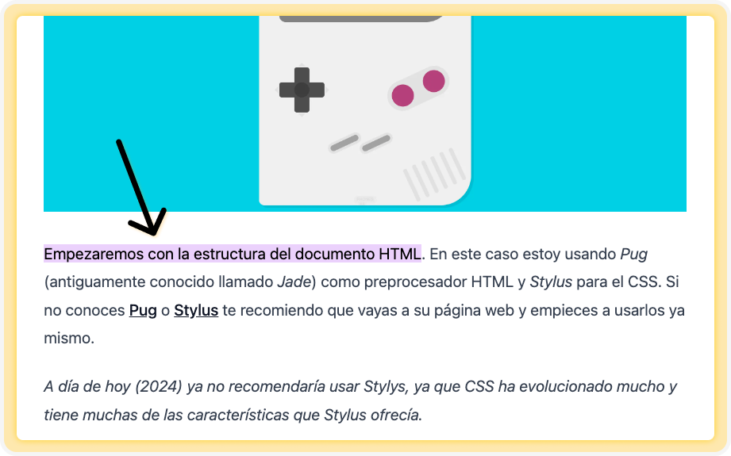
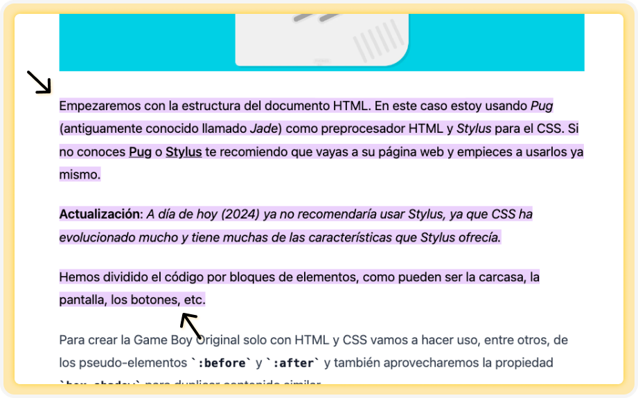
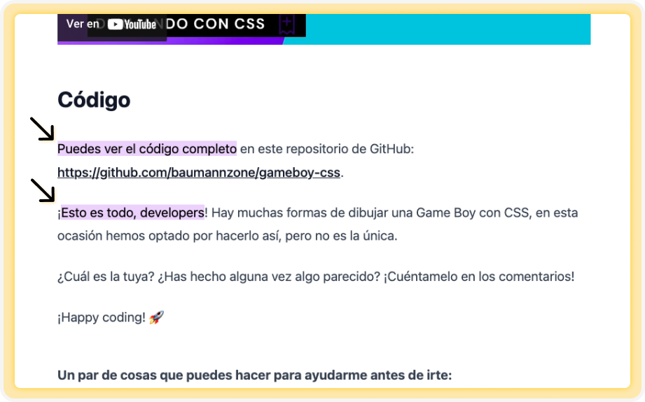
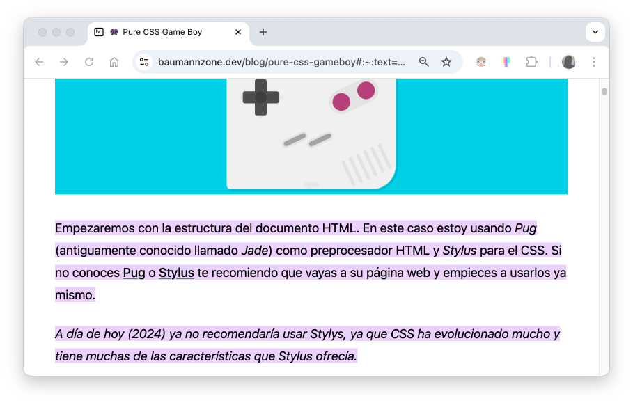
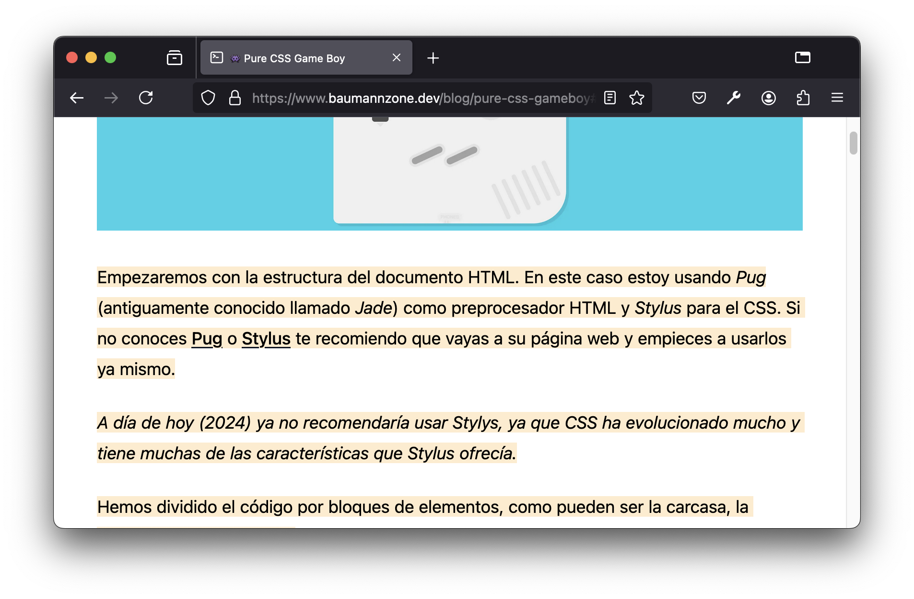
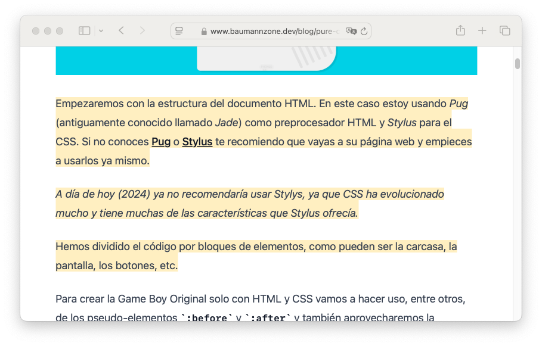
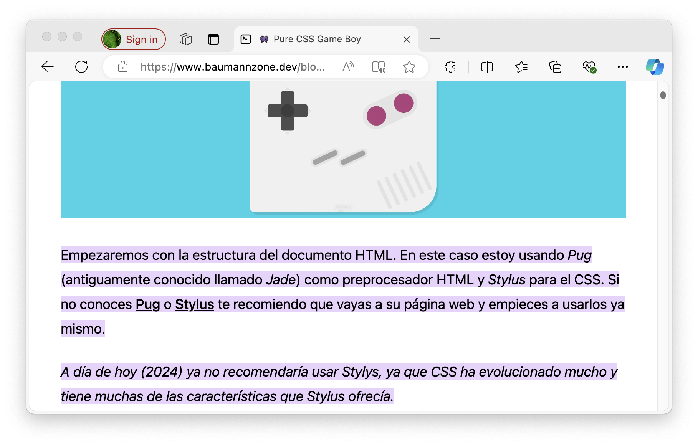
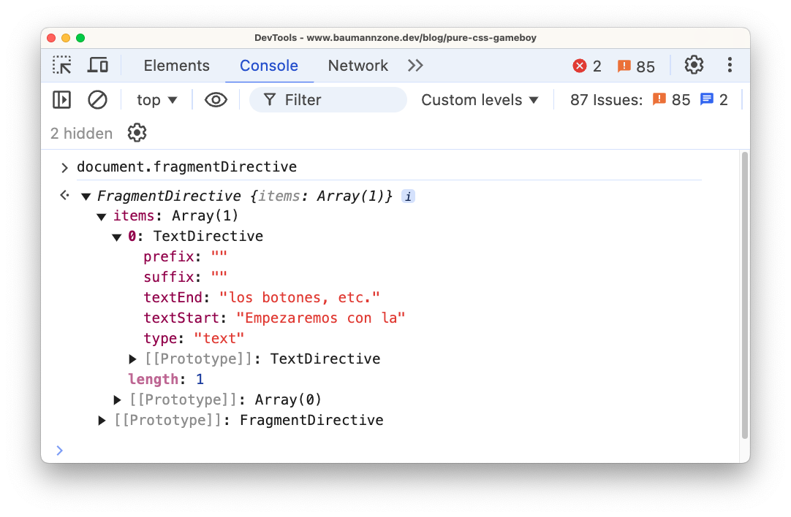
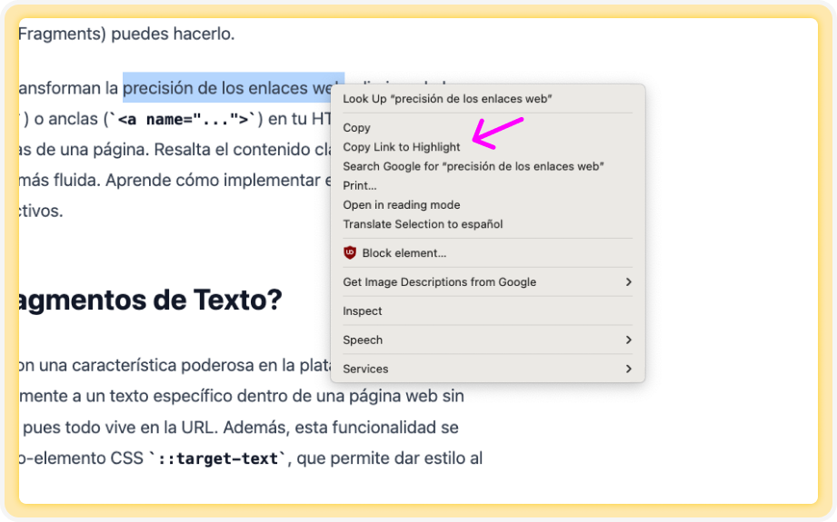

Para enlazar a una frase concreta de una página web basta con añadir `#:~:text=` y el texto al final de la URL: el navegador se desplaza hasta esa frase y la resalta. Se llaman Fragmentos de Texto (_Text Fragments_), no requieren tocar el HTML de la página de destino y funcionan en Chrome, Edge, Safari y Firefox.

Es lo que necesitas cuando quieres compartir un artículo y dirigir a alguien directamente al párrafo que te parece más interesante. Los Fragmentos de Texto eliminan la necesidad de tener IDs (`#`) o anclas (`<a name="...">`) en el HTML para apuntar a partes específicas de una página.

## ¿Qué son los Fragmentos de Texto?

Los Fragmentos de Texto son una característica de la plataforma web que permite enlazar directamente a un texto específico dentro de una página web sin necesidad de añadir lógica, pues todo vive en la URL. Además, esta funcionalidad se complementa con el pseudo-elemento CSS `::target-text`, que permite dar estilo al texto resaltado.

Los Fragmentos de Texto funcionan añadiendo una sintaxis especial al final de una URL (`#:~:text=`), similar a cómo agregamos el ID de un elemento en un enlace. El navegador interpreta esta parte de la URL, busca el texto especificado en la página y, si admite Fragmentos de Texto, se desplaza y resalta ese texto. Cuando el usuario navega usando la tecla Tab, el foco se moverá al siguiente elemento después del fragmento.

## ¿Cómo se usan los Fragmentos de Texto?

La sintaxis básica para una URL con Fragmento de Texto es la siguiente:

```
ejemplo.com/pagina.html#:~:text=[prefijo-,]inicioTexto[,finTexto][,-sufijo]
```

Después del símbolo de almohadilla `#`, añadimos la sintaxis especial `:~:` llamada _fragment directive_, seguida de `text=` y los siguientes parámetros. Solo `inicioTexto` es obligatorio:

- `prefijo-`: Texto que precede inmediatamente al contenido deseado, útil para cuando existen múltiples coincidencias (no se resalta).
- `inicioTexto`: El texto de inicio que quieres resaltar.
- `finTexto`: El texto final (opcional) para delimitar el fragmento resaltado.
- `-sufijo`: Similar al prefijo pero colocado después del texto, ideal cuando hay varias coincidencias (tampoco se resalta).

| Lo que quieres                              | Fragmento                             |
| :------------------------------------------ | :------------------------------------ |
| Resaltar una frase exacta                   | `#:~:text=frase%20exacta`             |
| Resaltar desde un texto hasta otro          | `#:~:text=inicio,final`               |
| Elegir una coincidencia por lo que hay antes | `#:~:text=antes-,texto`              |
| Elegir una coincidencia por lo que hay después | `#:~:text=texto,-despu%C3%A9s`     |
| Resaltar varios textos                      | `#:~:text=uno&text=dos`               |
| Ir a un ID y además resaltar un texto       | `#seccion:~:text=texto`               |

Por ejemplo, si queremos enlazar a un artículo sobre la Game Boy con CSS puro y resaltar la sección de la estructura HTML, la URL sería:

```
baumannzone.dev/blog/pure-css-gameboy#:~:text=Empezaremos%20con%20la%20estructura%20del%20documento%20HTML
```

En este caso, el fragmento de texto resaltado es "_Empezaremos con la estructura del documento HTML_" (codificado). Si sigues [el enlace](https://www.baumannzone.dev/blog/pure-css-gameboy/#:~:text=Empezaremos%20con%20la%20estructura%20del%20documento%20HTML), el navegador buscará ese texto en la página y lo resaltará. Así es como se ve en **Chrome**:



### Rangos de fragmentos de texto

Si el texto que vas a resaltar es muy largo, puedes resaltar un rango de texto especificando tanto el texto inicial como el final, separados por una coma.

```
baumannzone.dev/blog/pure-css-gameboy#:~:text=Empezaremos%20con%20la,los%20botones%2C%20etc.
```

Aquí el fragmento resaltado va desde "_Empezaremos con la_" hasta "_los botones, etc._".

Si sigues [este link](https://www.baumannzone.dev/blog/pure-css-gameboy/#:~:text=Empezaremos%20con%20la,los%20botones%2C%20etc.), deberías ver algo como esto:



### Múltiples fragmentos de texto

Si quieres resaltar múltiples fragmentos de texto, puedes hacerlo usando el ampersand `&` para separar cada fragmento de texto.

```
baumannzone.dev/blog/pure-css-gameboy#:~:text=Puedes%20ver%20el%20c%C3%B3digo%20completo&text=Esto%20es%20todo%2c%20developers
```

En este caso, se resaltarán dos fragmentos de texto: "_Puedes ver el código completo_" y "_Esto es todo, developers_". En [este enlace](https://www.baumannzone.dev/blog/pure-css-gameboy/#:~:text=Puedes%20ver%20el%20c%C3%B3digo%20completo&text=Esto%20es%20todo%2c%20developers) se ve así:



Otro comportamiento interesante de los Fragmentos de Texto es que, si enlazamos a contenido oculto que puede ser descubierto mediante la función de búsqueda (por ejemplo, un elemento `details` / `summary` cerrado), el contenido oculto se hará visible, aunque esto puede variar según el navegador.

## Dar estilo a los Fragmentos de Texto

El pseudo-elemento CSS `::target-text` representa el texto al que se ha desplazado si tu navegador admite fragmentos de texto. Permite a los developers decidir cómo resaltar esa sección de texto.

```css
::target-text {
  background-color: gold;
}
```

Con este código, el texto resaltado por un fragmento de texto se mostrará con un fondo dorado. Puedes personalizar los estilos según tus preferencias, pero ten en cuenta que solo puedes personalizar estas propiedades:

- `color`
- `background-color`
- `text-decoration`
- `text-shadow`
- `stroke-color`, `fill-color` y `stroke-width`

## Soporte en navegadores

Los fragmentos de texto son compatibles con todos los navegadores principales. Firefox fue el último en incorporarlos, en octubre de 2024, y Safari ya admite también el pseudo-elemento `::target-text`.

| Característica                | Chrome y Edge | Safari | Firefox |
| :---------------------------- | :------------ | :----- | :------ |
| Enlaces con `#:~:text=`       | 80            | 16.1   | 131     |
| `::target-text`               | 89            | 18.2   | 131     |
| `document.fragmentDirective`  | 86            | 18.4   | 131     |

Si un navegador no soporta esta función, simplemente cargará la página sin resaltar o desplazar el texto.

La apariencia predeterminada del resaltado varía entre navegadores. Safari resalta el área completa de la línea, mientras que Firefox, Edge y Chrome solo resaltan el texto, dejando espacios vacíos entre líneas.

**Chrome**


**Firefox Developer Edition**


**Safari**


**Edge**


Desde JavaScript puedes verificar si el navegador soporta esta característica usando `document.fragmentDirective`. Si está soportado, devolverá un objeto `FragmentDirective`; en caso contrario, devolverá `undefined`.

```js
if ("fragmentDirective" in document) {
  // => Soportado
} else {
  // => No soportado
}
```

En Chrome, el objeto `FragmentDirective` incluye una lista `items` con los valores de `prefix`, `suffix`, `textStart` y `textEnd` de cada fragmento:



No cuentes con esos datos en producción: MDN documenta el objeto como vacío y pensado, por ahora, solo para detectar el soporte, así que lo que ves en la captura es algo propio de Chrome.

Ten en cuenta que Safari admitió los enlaces (16.1) bastante antes que esta propiedad (18.4), así que en versiones intermedias la comprobación da `false` aunque los fragmentos funcionen.

## Consideraciones prácticas

- Las cadenas de texto utilizadas para los valores de `textStart`, `textEnd`, `prefix-` y `-suffix` deben estar codificadas en URI. Eso incluye los caracteres que la propia sintaxis usa como separadores: el guion (`%2D`), la coma (`%2C`) y el ampersand (`%26`).
- Los fragmentos de texto no son sensibles a mayúsculas y minúsculas.
- El texto tiene que coincidir con palabras completas: `text=java` no resalta la palabra "javascript".
- Solo se aplican en navegaciones iniciadas por el usuario, como hacer clic en un enlace. Una redirección hecha con JavaScript no los activa.
- Por seguridad, si el enlace apunta a otro dominio y se abre en una ventana nueva, debe hacerlo con `rel="noopener"` (o `noopener` en `window.open()`).
- Los fragmentos de texto solo funcionan en el documento principal. No funcionarán dentro de un `<iframe>`.
- Un sitio puede desactivarlos para sus páginas enviando la cabecera `Document-Policy: force-load-at-top`, aunque solo la respetan los navegadores basados en Chromium.

Una característica interesante que tiene Google Chrome es que puedes copiar el enlace con el fragmento de texto resaltado directamente desde el navegador. Solo tienes que seleccionar un texto, hacer clic derecho sobre él y elegir "_Copiar enlace al texto destacado_" o "_Copy Link to Highlight_".



## Notas finales

La primera vez que vi los fragmentos de texto fue en los resultados de búsqueda de Google, donde resaltan las palabras clave que buscas. Al principio pensaba que era una característica exclusiva de Google, pero me alegra saber que es una funcionalidad estándar en la web, disponible para cualquier navegador que decida implementarla.

¿Tú la conocías? ¿Te parece útil? Te leo.

## Fuentes

- [Text fragments](https://developer.mozilla.org/en-US/docs/Web/URI/Reference/Fragment/Text_fragments), en MDN (en inglés), con la tabla de compatibilidad de navegadores.
- [URL Fragment Text Directives](https://wicg.github.io/scroll-to-text-fragment/), la especificación del WICG (en inglés).
- [`::target-text`](https://developer.mozilla.org/en-US/docs/Web/CSS/Reference/Selectors/::target-text), en MDN (en inglés).
- [Boldly link where no one has linked before: Text Fragments](https://web.dev/articles/text-fragments), el artículo de web.dev sobre esta característica (en inglés).
