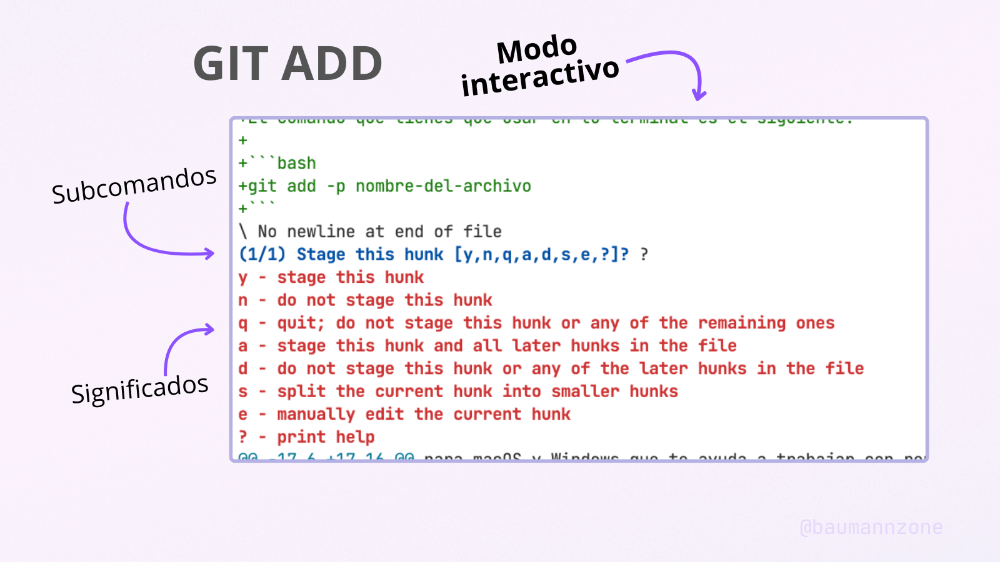

Git Tower es un cliente gráfico de Git para macOS y Windows. Lo uso desde hace años por tres funciones: deshacer casi cualquier acción con un atajo de teclado, hacer cherry-picks o reordenar commits arrastrando y soltando, y elegir qué líneas de un archivo entran en cada commit.

> **Aviso:** este post contiene enlaces de afiliado. Si compras Git Tower a través de ellos, recibo una comisión sin coste extra para ti.

Usar Git desde la terminal es algo que deberías dominar si quieres progresar como desarrollador. Sin embargo, si prefieres una interfaz gráfica, [Git Tower](https://www.git-tower.com/?via=baumannzone) es una excelente alternativa.

## ¿Qué es Git Tower?

[](https://www.git-tower.com/?via=baumannzone)

Git Tower no es simplemente otro cliente Git con interfaz gráfica. Se trata de una herramienta profesional que revoluciona la manera de trabajar con Git. Llevo años utilizándolo y, gracias a esta experiencia, puedo afirmar que ha transformado mi flujo de trabajo y, sobre todo, mi comprensión de Git.

Sí, he aprendido mucho sobre Git gracias a Tower, sigue leyendo y al final te cuento cómo.

Detrás de cada acción que realizamos en cualquier cliente gráfico de Git, existe un comando de Git. Tiene sentido, ¿no?

A noviembre de 2026, la versión actual es la 18 en macOS y la 15 en Windows. Todo lo que te cuento en este post funciona en los dos sistemas.

## Deshacer con `⌘ + Z`

Esta es una de las funcionalidades que más me gustan de Git Tower. La que más uso en mi día a día como desarrollador.

¿Te imaginas deshacer tus cambios en Git con un simple clic? Tower ofrece justo eso y más: deshaces la última acción con `⌘ + Z` en macOS o con `Ctrl + Z` en Windows.

- Creas una rama nueva y quieres volver atrás: `⌘ + Z`
- Haces un commit y te das cuenta de que te has equivocado: `⌘ + Z`
- Borras un stash por error: `⌘ + Z`

También puedes deshacer un merge, un rebase, el borrado de una rama o los cambios que has descartado de un archivo.

<figure>
<video width="100%" controls loop autoplay muted>
  <source src="https://res.cloudinary.com/baumannzone/video/upload/v1738190748/BlogBaumannzone.dev/git-tower-cmd-z.mp4" type="video/mp4">
</video>
<figcaption>En el video se muestra cómo se crea una rama y con <code>⌘ + Z</code> se deshace la acción, haciendo que la rama desaparezca. Si luego cambias de opinión y deseas conservar la rama, puedes pulsar <code>Shift + ⌘ + Z</code> para rehacerla.</figcaption>
</figure>

Si después de deshacer una acción te das cuenta de que no era lo que querías hacer, siempre puedes rehacerla con `Shift + ⌘ + Z` (`Shift + Ctrl + Z` en Windows). ¡Magia! 🔮

## Arrastra todo en Git Tower con Drag & Drop

Una de las características más irresistibles de [Git Tower](https://www.git-tower.com/?via=baumannzone) es la posibilidad de arrastrar y soltar prácticamente cualquier elemento dentro de la aplicación.

- Quieres hacer un cherry-pick: arrastra el commit a tu rama actual
- Quieres reordenar tus commits: arrastra el commit a su nueva posición en el historial
- Quieres juntar dos commits (squash): suelta uno encima del otro
- Quieres hacer merge de una rama: arrástrala sobre tu rama actual (si mantienes pulsado `⌥`, hace un rebase)
- Quieres hacer push: arrastra la rama a la sección del remoto
- Quieres guardar cambios en un stash: arrastra los archivos a la sección de stashes
- Quieres abrir una pull request: arrastra la rama a la sección de pull requests

<figure>
<video width="100%" controls loop autoplay muted>
  <source src="https://res.cloudinary.com/baumannzone/video/upload/v1738259325/BlogBaumannzone.dev/git-tower-drag-and-drop.mp4" type="video/mp4">
</video>
<figcaption>Arrastrar y soltar commits en Git Tower para hacer cherry-pick o cambiar su orden en el historial.</figcaption>
</figure>

## Desbloquea el modo interactivo de `git add` y conviértete en la GOAT

He aprendido mucho sobre todas las posibilidades que ofrece Git gracias a Git Tower. **¿Cuántas veces has ejecutado un comando de Git sin saber qué hace realmente por detrás?** Yo lo he hecho muchas veces.

🤯 Te voy a dar un ejemplo que me voló la cabeza cuando lo descubrí y que me hizo ser mejor programador. ¡Este es mi trucazo secreto!

**¿Sabías que puedes seleccionar las líneas de código que quieres agregar a un commit?** Me explico, en vez de agregar todos los cambios del archivo, puedes seleccionar las líneas que quieres agregar y dejar otras fuera del commit.

En Tower es tan fácil como seleccionar las líneas en el diff del archivo y añadirlas al _stage_. Solo esas líneas entran en el próximo commit; el resto de cambios se quedan en tu copia de trabajo.

En la terminal, el comando que tienes que usar es el siguiente:

```bash
git add -p nombre-del-archivo
```

Una vez que ejecutes ese comando, entrarás en el **modo interactivo** y Git te mostrará tus cambios en bloques (también llamados "_hunks_"). Para cada uno, podrás elegir:

- `y` para agregarlos al commit
- `n` para omitirlos
- `s` para dividirlos en trozos más pequeños
- `e` para editar manualmente qué líneas se incluyen
- y más opciones que puedes ver en la ayuda (`?`)

[](https://www.git-tower.com/?via=baumannzone)

En la imagen se puede ver la acción que puedes realizar (`Stage this hunk`) y el listado de subcomandos disponibles para cada hunk: `[y, n, q, a, d, s, e, ?]`.

En el modo interactivo, puedes elegir qué líneas quieres agregar a tu commit y cuáles no. Esto es muy útil si, por ejemplo, has editado varias partes de un archivo (como el `<header>` y el `<footer>` de tu `index.html`) y quieres hacer un commit parcial para tener todo organizado y separado por funcionalidades.

Esta funcionalidad viene por defecto con Git, no es algo exclusivo de Tower. Sin embargo, la primera vez que la utilicé fue precisamente gracias a Tower. A partir de ahí, empecé a profundizar más en Git y a interesarme por los comandos que hay detrás de cada acción.

## Conclusiones finales

Para cerrar, no olvides que **existen varias alternativas gratuitas** a Git Tower, como GitHub Desktop, el control de código fuente de VS Code o lazygit en la terminal. Sin embargo, si usas Git y GitHub a diario, Git Tower puede transformarse en tu mejor aliado. Al ser de pago (a noviembre de 2026, desde 59 € al año), el equipo invierte recursos en mejoras constantes y soporte de calidad, lo cual se traduce en un producto mucho más robusto.

Además, **si eres estudiante universitario**, tienes [6 meses gratis de Tower Pro](https://www.git-tower.com/students/mac?via=bmn) y, después, un 70 % de descuento mientras sigas estudiando.

¡Y esto es todo! Espero que mis trucazos secretos y experiencias con Git Tower te sirvan para optimizar tu flujo de trabajo y sacarle el máximo provecho a Git.

Si quieres probar Git Tower, puedes descargar una versión de prueba de 30 días, sin tarjeta de crédito, desde su [página web](https://www.git-tower.com/?via=baumannzone). Si decides comprar una licencia, puedes hacerlo a través de mi enlace de afiliado y me ayudarás a seguir creando contenido como este. 🫶

Y si te gusta reescribir commits, mira también [`git history`, el nuevo comando experimental de Git](/blog/git-history-el-nuevo-comando-experimental-para-reescribir-commits-de-git/).

## Fuentes

- [Undo](https://www.git-tower.com/features/undo), en la web de Git Tower.
- [Drag and Drop](https://www.git-tower.com/features/drag-and-drop), en la web de Git Tower.
- [`git add --patch`](https://git-scm.com/docs/git-add#Documentation/git-add.txt---patch), en la documentación oficial de Git.
