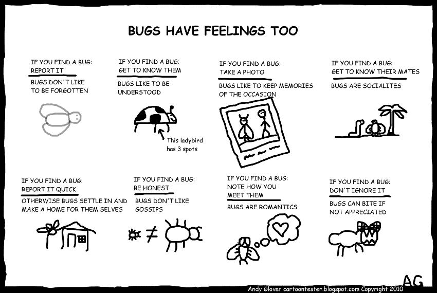
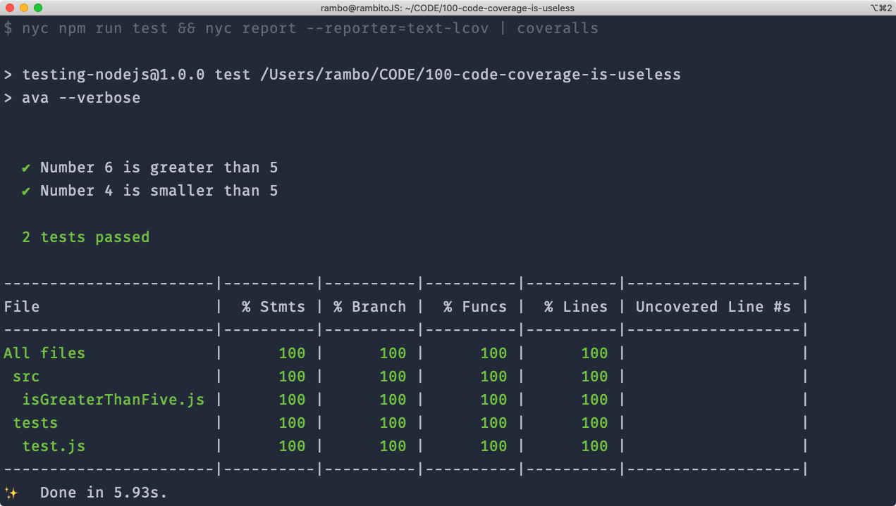

Un 100% de cobertura de código (_code coverage_) solo significa que tus tests ejecutan todas las líneas, no que comprueben que hacen lo correcto. Puedes tener un 100% y un bug evidente, como te enseño más abajo con un ejemplo real. La cobertura es útil para encontrar código sin probar, pero no como objetivo.

En este escrito te hablo de la cobertura de código, de por qué es tan importante y de por qué no deberías obsesionarte con ella.

## Code Coverage, ¿qué es?

La cobertura de código es una medida del porcentaje de líneas de código ejecutadas, es decir, cubiertas, durante la ejecución de las pruebas o tests.

Simplificando, te indica cuántas líneas de tu código están cubiertas por sus pruebas. Lo más habitual es que el code coverage se mida en porcentaje, donde `100%` de code coverage significa que todo tu código está cubierto cuando ejecutas los tests y `0%` de code coverage significa que ninguna línea de tu código se ejecuta cuando corres los tests.

A ver si lo entiendo. Te obsesionas con el número de líneas de código cubiertas por un test como si fuera una medición de éxito. Has pasado de lo que debería ser una referencia objetiva a una especie de videojuego adictivo, donde nos obsesionamos con 'subir de nivel' o 'puntuar más alto' para satisfacer estas métricas.

La sensación de seguridad que nos da alcanzar esa dulce cifra del 100% de cobertura puede ser tan ilusoria como los duendes al final de un arco iris. Ahí estás tú, creyendo que tu código es un chaleco Kevlar, cuando en realidad es un queso Emmental 🧀, lleno de agujeros.

Y si estás ahí, persiguiendo esa perfección del 100% de cobertura, seguramente estés más enfocado en incrementar tu puntuación en este videojuego imaginario de "_El gran coberturista_", en lugar de escribir código que sea tan fácil de leer y de mantener (como una planta de plástico).

## Testing para ganar velocidad

Seguro que cuando eras joven e inocente y empezaste a escribir tests, con brillo en los ojos, lo querías testear todo. Tienes que tener en cuenta que escribes tests para ganar velocidad y tener confianza.

Por lo tanto, **es importante saber qué testear** ya que no todo es igual de importante. Aunque no será fácil al principio, el tiempo y la experiencia te darán ese conocimiento, independientemente de la metodología que sigas o del tipo de tests que estés escribiendo.

Esto nos lleva a la siguiente premisa:

> El testing puede ralentizar tus desarrollos

(Ya puedes ir corriendo a decirle a tu jefe que no haces tests porque "_no tienes tiempo_". Si eres de la **generación Z**, puedes decir algo como "_no me renta_").

Si tus tests tardan más en escribirse y en mantenerse que el tiempo que te ahorran, tal vez no deberías estar escribiendo esos tests. Esto puede pasar cuando trabajas con proyectos inestables, prototipos, pruebas de concepto o similares, que pueden cambiar de rumbo fácilmente.

Sin embargo, en proyectos estables, grandes y de larga duración, tener pruebas automáticas da sus frutos. Aunque seguramente no necesites tantos tests como crees.



## El mito del 100% Code Coverage

El "procedimiento oficial" es bastante sencillo, no te preocupes: primero, conviertes ideas en algoritmos para que las mentes simples (¡sí, los humanos!) comprendan tu código. Luego, cubres todo con tests para garantizar que estos seres tan propensos al error no arruinen tu obra.

Puedes cubrir hasta el último rincón de tu código con tests y sentirte muy orgulloso de tu impresionante porcentaje de coverage, pero, ¿realmente eso significa algo? Sólo una persona que realmente entienda lo que está mirando, con conocimientos profundos y con café en mano, podría decirte si tus tests son válidos o si solo estás jugando al escondite con tu propio código.

Podrías limitarte a escribir tests que hagan parecer bonitas las métricas de cobertura de código, que complazcan a esa pequeña obsesión que tienes con los números altos. Pero, ¿quién haría algo tan absurdo? ¡Seguro que tú no! Porque, al final del día, sabes que eso solo conseguiría convertir tu código en un chiste de mal gusto. Tú esto ya lo sabías, ¿verdad?

Podría decir que el testing es como ir a correr. Con los primeros entrenamientos irás mejorando rápidamente y al cabo de unas semanas estarás con una condición física notablemente superior que cuando empezaste. Solo con dedicarle un par de horas a la semana, te sentirás mejor, más fuerte, con más energía e incluso, habrás perdido peso.

Sin embargo, llegará un punto en el que para conseguir una pequeña mejora en tu rendimiento necesites invertir mucho más esfuerzo y entrenamiento del que estabas acostumbrado a hacer, es decir, cada hora extra de entrenamiento te va a proporcionar un beneficio menor. Para mejorar solo un poquito más, necesitas esforzarte mucho más.

Cuando haces tests pasa lo mismo. Puedes escribir unos cuantos tests que cubran las features más importantes de tu aplicación en unas cuantas horas. Después de esto, incrementar el code coverage se convierte en una tarea cada vez más difícil.

Por lo tanto, si intentas llegar al ansiado 100% de code coverage, el santo grial del mundo del desarrollo, te vas a sentir como una babosa subiendo una duna de arena. Pero quién sabe, quizás estés hecho de un material más resistente que la babosa promedio. ¿Quién soy yo para juzgarte?

Recapitulando, fijarte como meta alcanzar el 100% de cobertura en todos tus proyectos es como aspirar a capturar un unicornio en medio de un bosque encantado. Es bonito de imaginar, pero no es lo que necesitas.

Sin embargo, en el mundo del desarrollo siempre hay excepciones. Supón que estás trabajando en una aplicación de pagos en la que un pequeño error es más costoso que comprarle un Mac Pro con todos los extras a toda tu familia. En ese caso, perseguir ese unicornio del 100% de cobertura podría tener mucho sentido. Sólo asegúrate de tener suficiente paciencia y café.

## La falacia del 100% Code Coverage

Ha llegado la hora de desenmascarar la gran ilusión del 100% code coverage. Para que lo puedas ver mejor, he creado un [repositorio en GitHub](https://github.com/baumannzone/100-code-coverage-is-useless) que tiene un proyecto en Node.js con sus pruebas unitarias y el correspondiente [reporte de code coverage](https://100-code-coverage-is-useless.netlify.app/coverage/).

Para ejecutar estas pruebas y generar el famoso informe de cobertura, he utilizado dos de las herramientas más _chic_ en la comunidad JavaScript: [AVA](https://github.com/avajs/ava) y [nyc](https://github.com/istanbuljs/nyc), pero eso es lo de menos, puede ser cualquier otra herramienta. Hoy, por ejemplo, Jest y Vitest ya traen la cobertura integrada.

Para darle un poco más de sabor a todo esto, aquí tienes una imagen de lo que parece ser... ¡Sí, lo adivinaste! ¡Un glorioso 100% de cobertura de código! ¿No te parece majestuoso?



Antes de que empieces a alzar tus brazos en señal de victoria, recuerda: Este precioso gráfico es tan engañoso como un truco de magia bien ejecutado. No te dejes engañar por el color verde y las altas cifras.

Si has revisado a fondo el código y el informe de cobertura, puede que hayas notado algo peculiar. _¡Ajá!_ Ahora es cuando todo se vuelve interesante.

Hay un pequeño error en el código, tan hábilmente escondido que podría pasar desapercibido para las herramientas, pero no para un developer con ojo de águila. Observa la función `isGreaterThanFive` (puedes verla en el archivo `isGreaterThanFive.js`). Se supone que debería decirnos si el número que recibe como argumento es mayor que cinco. Sin embargo, como un traidor en nuestras filas, ¡realiza una comparación de mayor o igual que cinco!

```javascript
// src/isGreaterThanFive.js
const isGreaterThanFive = (num) => {
  if (num >= 5) {
    return true;
  } else {
    return false;
  }
};
```

Y estos son los tests, que pasan los dos:

```javascript
// tests/test.js
test("Number 6 is greater than 5", (t) => {
  t.is(isGreaterThanFive(6), true);
});

test("Number 4 is smaller than 5", (t) => {
  t.is(isGreaterThanFive(4), false);
});
```

Los tests recorren las dos ramas del `if`, así que la herramienta marca todo en verde. Pero nadie prueba el caso límite, el `5`, que es justo donde está el bug: `isGreaterThanFive(5)` devuelve `true`.

¡Toma ya! ¿Un 100% de cobertura y todavía hay errores? ¿¡Cómo puede ser esto!? Esto nos lleva a otra importante premisa:

> 100% de code coverage no significa que tu código esté libre de errores.

Resulta que este porcentaje no es más que una distracción para que bajemos la guardia y nos olvidemos de que los errores pueden seguir acechando en la sombra.

## Líneas, ramas y por qué ni así basta

La cobertura no es un único número. Las herramientas suelen medir cuatro cosas:

- **Sentencias** (_statements_): cuántas instrucciones se han ejecutado.
- **Ramas** (_branches_): cuántos caminos de cada `if`, `switch` o ternario se han recorrido.
- **Funciones**: cuántas funciones se han llamado al menos una vez.
- **Líneas**: cuántas líneas se han ejecutado.

La cobertura de ramas es la más exigente de las cuatro, y aun así, en el ejemplo también está al 100%. Ninguna de estas métricas comprueba si tus aserciones son buenas, solo si el código se ha ejecutado.

## Qué hacer en su lugar: mutation testing

Si quieres saber si tus tests detectan errores de verdad, existe una técnica que hace justo eso: el **mutation testing** (pruebas de mutación).

La idea es sencilla. Una herramienta como [Stryker](https://stryker-mutator.io/) introduce pequeños cambios en tu código, llamados mutantes, y vuelve a ejecutar los tests. Por ejemplo, cambia `>=` por `>`, o `true` por `false`.

- Si algún test falla, el mutante "muere": tus tests han detectado el cambio. 👍
- Si todos los tests siguen pasando, el mutante "sobrevive": hay un cambio en tu código que tus tests no notan. 👎

En nuestro ejemplo, cambiar `num >= 5` por `num > 5` no rompe ningún test, así que ese mutante sobreviviría y te señalaría exactamente el caso que falta probar. Es más lento que medir la cobertura, pero te dice algo mucho más útil: no qué código se ejecuta, sino qué código está realmente comprobado.

## Máquinas vs Humanos

Aquí es donde tratamos el eterno debate de las máquinas versus los humanos.

Uno de los problemas con la cobertura de código es que para una herramienta automatizada, todas las líneas de código cubiertas son igual de importantes. Es como si el sistema se pusiera unas gafas de sol y viera todo en el mismo tono de gris. No importa si estás probando el corazón de tu aplicación, el "carrito de compras", o si estás revisando la sección de "preguntas frecuentes".

En términos de la importancia para el negocio, está claro que el "carrito" se lleva el premio mayor. Pero, ¿acaso el porcentaje de cobertura de código te lo hará saber? No. Las herramientas simplemente no tienen ese grado de sofisticación o juicio. No todavía.

Por lo tanto, aunque las máquinas pueden acelerar nuestra capacidad para completar tareas, somos los humanos los que tomamos las decisiones cruciales en el proceso.

## TL;DR

- Estoy a favor del 100% de code coverage.
- Estoy en contra del over-testing, solo por los puntos del juego.
- 100% code coverage es OK. El problema es el 100% de _bullshit_.
- 100% code coverage no siempre significa que tu código esté libre de errores.
- Code coverage puede darte falsa sensación de seguridad y confianza.

Y la última, al contrario de lo que tal vez estés pensando:

> La cobertura de código es realmente útil. Pero no deberías confiar en ella a ciegas.

## Conclusión

La cobertura del código es una herramienta, no un objetivo final. No te dejes deslumbrar por el brillo de un 100% de cobertura.

Nunca subestimes el valor del juicio humano. Aunque las máquinas pueden ayudarnos a correr más rápido, al final del día, somos nosotros los que decidimos hacia dónde correr.

La próxima vez que estés escribiendo pruebas, pregúntate: "¿_Estoy añadiendo valor con estos tests, o simplemente estoy jugando al juego de la cobertura del código_?".

El testing no se trata de conseguir la mayor puntuación. Se trata de hacer tu código mejor y más seguro. Sal ahí y escribe tests que valgan la pena.

Si estás empezando con los tests, te recomiendo [este artículo para empezar a testear con JavaScript](/blog/testing-con-javascript/), desde cero hasta Jest.

¡Happy testing!

## Fuentes

- [Test Coverage](https://martinfowler.com/bliki/TestCoverage.html), de Martin Fowler.
- [Code Coverage Best Practices](https://testing.googleblog.com/2020/08/code-coverage-best-practices.html), en el blog de testing de Google.
- [Stryker Mutator](https://stryker-mutator.io/), la herramienta de mutation testing para JavaScript.
- [El repositorio del ejemplo](https://github.com/baumannzone/100-code-coverage-is-useless), en GitHub.
