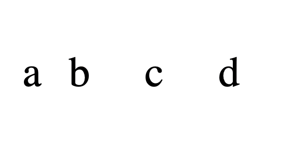

`letter-spacing` no añade espacio _entre_ las letras, como su nombre da a entender: los navegadores lo añaden _después_ de cada letra, también de la última. Por eso queda un hueco sobrante al final de cada palabra y de cada línea, y los textos centrados se ven desplazados. La especificación ya tiene una solución, pero ningún navegador la implementa todavía.

El espaciado de letras o letter-spacing en CSS parece una propiedad sencilla, ¿verdad? Ajustar el espacio entre letras no debería ser un problema. Pero te han mentido. Lo que parece inofensivo puede estar desmoronando la estética de tus diseños sin que lo notes.

Es probable que hayas estado usando mal el espaciado de letras todo este tiempo. Y lo peor es que este error pasa desapercibido para la mayoría de los desarrolladores y diseñadores. Sus efectos se manifiestan en la alineación y el ritmo visual de tus textos.

Pero no te preocupes, hoy entenderás por qué `letter-spacing` está roto en CSS.

## ¿Qué es `letter-spacing` en CSS?

La pregunta es obvia, pero vale la pena responderla. `letter-spacing` es una propiedad de CSS que te permite ajustar el espacio entre las letras de un texto. Puedes usar valores positivos o negativos para aumentar o disminuir el espacio entre las letras.

```css
h1 {
  letter-spacing: 16px;
}
```

En este caso, el espaciado entre las letras de todos los títulos `<h1>` será de `16px`. Si quieres reducir el espacio, puedes usar un valor más pequeño o un valor negativo:

```css
h1 {
  letter-spacing: -2px;
}
```

## ¿Por qué `letter-spacing` está roto?

Durante años, la especificación decía lo siguiente: "_Specifies additional spacing between typographic character units_" (traducido: "Especifica el espaciado adicional entre unidades de caracteres tipográficos").

Por lo tanto, si tienes este código HTML:

```html
<p>a<span>bc</span>d</p>
```

y este código CSS:

```css
p {
  letter-spacing: 1rem;
}

span {
  letter-spacing: 2rem;
}
```

El resultado debería ser algo así:


Es decir, que el espaciado entre las letras `a` y `b` y entre las letras `c` y `d` debería ser de `1rem` y entre las letras `b` y `c` debería ser de `2rem`.

Sin embargo, si ejecutas este código en Chrome, verás que el espacio entre las letras `c` y `d` también es de `2rem`:


El motivo es que los navegadores no reparten el espacio _entre_ dos letras: se lo añaden a cada letra por su lado derecho (o por el final, en idiomas que se escriben de derecha a izquierda). La `c` está dentro del `<span>`, así que lleva pegados sus `2rem`, y esos `2rem` acaban entre la `c` y la `d`.



Y no es cosa solo de Chrome. Firefox por un lado, y Chrome y Safari por otro, lo implementan de forma ligeramente distinta, y ninguno sigue lo que decía la especificación.

## El problema que sí vas a notar: el espacio al final

Lo del `<span>` es un caso curioso, pero hay una consecuencia de este comportamiento que te afecta mucho más a menudo: **la última letra también lleva su espacio**.

Si aplicas `letter-spacing: 20px` a la palabra "ABC", no ocupa 40 px más (dos huecos), sino 60 px más: hay un hueco de 20 px después de la "C". Lo he medido en Chrome:

| Texto | Ancho |
| ----- | ----- |
| `ABC` sin `letter-spacing` | 82,25 px |
| `ABC` con `letter-spacing: 20px` | 142,25 px (60 px más) |

Ese hueco invisible hace que:

- Un texto **centrado** se vea desplazado hacia la izquierda, porque el navegador centra también el espacio sobrante. Pasa mucho en botones, etiquetas y títulos en mayúsculas, que es justo donde más se usa `letter-spacing`.
- Un texto **alineado a la derecha** no llegue del todo al borde.

## Cómo compensarlo hoy

Mientras los navegadores no cambien, la solución más sencilla es restar el mismo espacio al final con un margen negativo:

```css
.boton {
  letter-spacing: 0.2em;
  margin-inline-end: -0.2em;
}
```

Si no puedes tocar el margen, por ejemplo porque el elemento es un bloque, añade el mismo espacio al principio para que el texto quede equilibrado:

```css
.boton {
  letter-spacing: 0.2em;
  padding-inline-start: 0.2em;
}
```

Usar `em` en vez de `px` hace que la compensación se ajuste sola si cambias el tamaño de la fuente.

## ¿Qué esperar en el futuro?

Hay buenas noticias, aunque van lentas. En 2024 el CSSWG abrió un [issue para replantear el modelo de `letter-spacing`](https://github.com/w3c/csswg-drafts/issues/10193) y en junio de ese año aprobó un comportamiento nuevo:

- El espacio se reparte **a partes iguales a los dos lados** de cada letra, en vez de ponerlo todo detrás.
- El espacio sobrante **se recorta en los bordes de la línea**, así que desaparece el hueco del final.

Ese cambio ya está en el borrador de CSS Text Level 4. Lo que falta es que algún navegador lo implemente y compruebe que no rompe webs existentes, y a finales de 2026 ninguno lo ha hecho. Hasta entonces, toca compensarlo a mano.

## Conclusión

Ahora ya sabes por qué `letter-spacing` está roto en CSS: el espacio va detrás de cada letra, no entre ellas. La próxima vez que un botón en mayúsculas no te quede bien centrado, ya sabes a quién culpar.

Y si te gustan estos detalles tipográficos, mira también [cómo recortar el espacio sobrante del texto con `text-box`](/blog/text-box-en-css-recorta-el-espacio-sobrante-del-texto/), otro hueco invisible que CSS por fin permite controlar.

## Fuentes

- [Reconsidering the CSS letter-spacing model](https://github.com/w3c/csswg-drafts/issues/10193), el issue del CSSWG con la propuesta y la resolución.
- [La propiedad `letter-spacing`](https://drafts.csswg.org/css-text-4/#letter-spacing-property), en el borrador de CSS Text Level 4.
- [`letter-spacing`](https://developer.mozilla.org/en-US/docs/Web/CSS/Reference/Properties/letter-spacing), en MDN.
