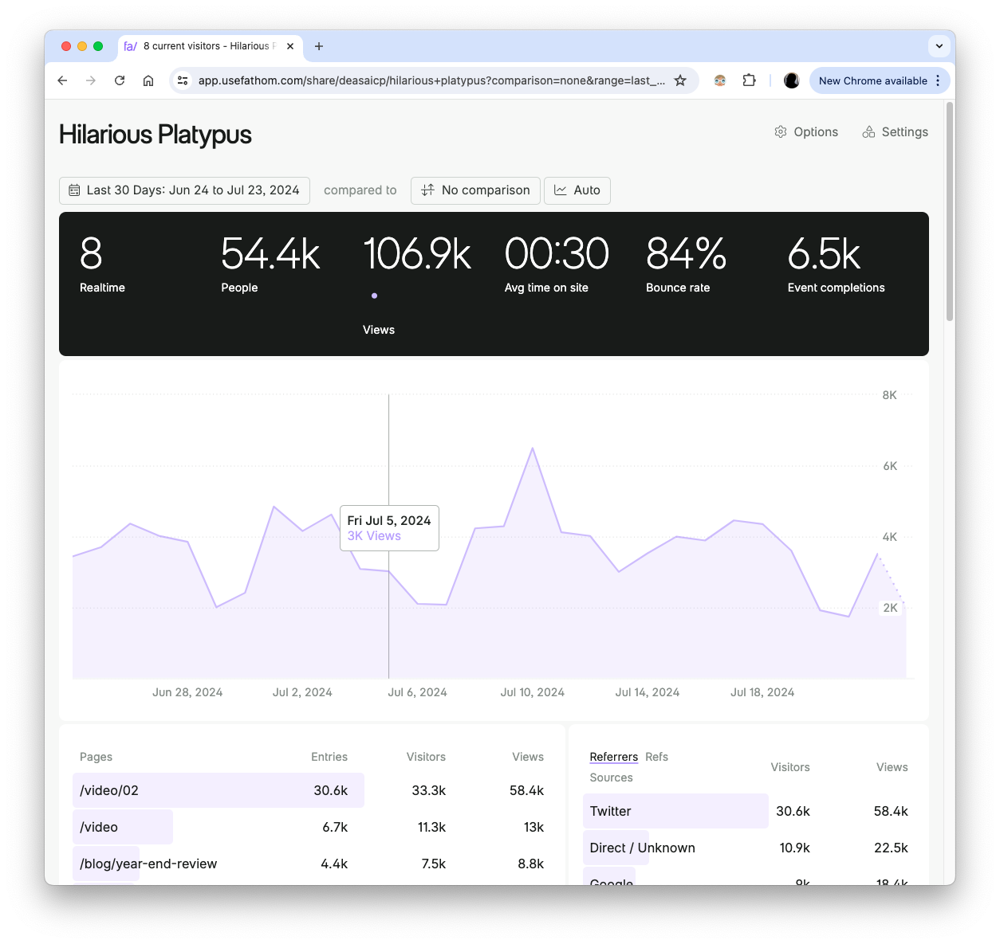

Si te preocupa la privacidad de tus usuarios, hay alternativas a Google Analytics que no usan cookies y pesan mucho menos. Yo uso **Fathom Analytics** desde agosto de 2022: su script pesa 2 KB comprimido, frente a los unos 157 KB del de Google Analytics, y no necesito aviso de cookies para medir las visitas.

Durante años, Google Analytics fue mi herramienta favorita para analizar el tráfico de mis webs. Aquí te cuento por qué la dejé y qué opciones tienes si quieres hacer lo mismo.

## El problema de Google Analytics

Google Analytics es popular por una razón: es gratuito y ofrece una gran cantidad de datos. Pero, ¿a qué precio? Cuando algo es gratis, **normalmente tú y tus usuarios sois el producto**.

Mis motivos para dejarlo son tres.

### Privacidad

Google Analytics usa cookies para reconocer a cada visitante y guarda los datos en servidores de Google. Además, por defecto puede compartir datos con otros productos y servicios de Google, aunque esa opción se puede desactivar en la configuración de la cuenta.

Para mí, la pregunta no es si se puede configurar bien, sino si necesito tantos datos de cada persona que visita mi blog. Y la respuesta es que no.

### El GDPR

Esto no es solo una cuestión de principios. En 2022, varias autoridades europeas de protección de datos decidieron que usar Google Analytics incumplía el GDPR, porque los datos de usuarios europeos acababan en Estados Unidos sin garantías suficientes:

- **Austria**, en enero de 2022, a raíz de una denuncia de la organización noyb.
- **Francia**, en febrero de 2022, cuando la CNIL ordenó a una web dejar de usarlo.
- **Italia**, en junio de 2022.

En julio de 2023, la Comisión Europea aprobó el Marco de Privacidad de Datos UE-EE. UU., que vuelve a permitir esas transferencias a empresas adheridas, como Google. Además, Google Analytics 4 ya no guarda las direcciones IP. Así que hoy usar Google Analytics no es ilegal por sí mismo, pero sigues necesitando el consentimiento de tus usuarios para sus cookies, y el marco legal ya ha cambiado más de una vez.

### Rendimiento

He medido los dos scripts:

| Script                      | Comprimido (gzip) | Sin comprimir |
| --------------------------- | ----------------- | ------------- |
| Google Analytics (`gtag.js`) | ~157 KB           | ~444 KB       |
| Fathom (`script.js`)        | ~2 KB             | ~7 KB         |

El de Fathom pesa unas 75 veces menos. En un blog donde cada artículo pesa poco, 157 KB de JavaScript solo para contar visitas es mucho.

## La alternativa que uso: Fathom Analytics

Decidí buscar una alternativa más ética y encontré Fathom Analytics. El cambio fue sorprendentemente sencillo, aunque, acostumbrados a tener todo gratis, el precio puede parecer un poco elevado. Para mí, la privacidad de mis usuarios es más importante que unos cuantos dólares al mes.

Con **una sola etiqueta `<script>`**, pude instalar Fathom y empezar a recibir datos:

```html
<!-- Cambia 123XYZ por el ID de tu sitio -->
<script src="https://cdn.usefathom.com/script.js" data-site="123XYZ" defer></script>
```

Fathom no usa cookies, así que no necesitas un aviso de cookies para la analítica. Eso no te libra de todo: sigues necesitando una política de privacidad que explique qué mides. Además, el diseño de las estadísticas es limpio y fácil de entender. Así se ve el panel de demostración de Fathom:



### Ventajas de usar Fathom Analytics

- Fácil de instalar y usar.
- Sin cookies, así que sin aviso de cookies para la analítica.
- Diseño limpio y sencillo de entender.
- Compartir las estadísticas con otras personas es muy fácil.
- Script muy ligero: unos 2 KB comprimido.

### Precio

Fathom tiene un plan inicial de **15 $ al mes** hasta 100.000 páginas vistas al mes, con una prueba gratuita de 7 días. Es el plan que uso desde agosto de 2022, y más de cuatro años después sigo midiendo esta web con él.

Si decides probarlo, con <a href="https://usefathom.com/ref/RAWNZT" rel="sponsored">mi enlace de referido</a> tienes 10 $ de crédito en tu primera factura.

> **Transparencia**: es un enlace de afiliado. Si te registras con él, Fathom me da una recompensa. No cambia lo que pagas ni lo que opino de Fathom: lo pago de mi bolsillo desde 2022.

## Otras alternativas a Google Analytics

Fathom no es la única opción. Estas son las más conocidas que respetan la privacidad:

| Herramienta      | Código abierto | Alojarla en tu servidor | Plan gratuito                   |
| ---------------- | -------------- | ----------------------- | ------------------------------- |
| Fathom           | No             | No                      | No (prueba de 7 días)           |
| Plausible        | Sí             | Sí                      | Solo alojándola tú              |
| Umami            | Sí             | Sí                      | Sí, también en su nube          |
| Simple Analytics | No             | No                      | Sí                              |
| Matomo           | Sí             | Sí                      | Solo alojándola tú              |
| GoatCounter      | Sí             | Sí                      | Sí, para uso público razonable  |

Los planes cambian a menudo, así que revisa sus webs antes de decidir. Si no quieres pagar y no te importa mantener un servidor, Umami, Plausible o Matomo alojados por ti son buenas opciones.

## Conclusión

Desde que uso Fathom Analytics, mantener la web me cuesta 15 $ al mes, pero la tranquilidad de saber que protejo la privacidad de mis usuarios lo vale.

Google Analytics es una herramienta potente, pero también invasiva para lo que necesita un blog. Si te preocupa la privacidad de tus usuarios, prueba una alternativa. Además de respetar a quien te lee, tu web cargará menos JavaScript.

Y si recomiendas herramientas con enlaces de afiliado, como hago yo aquí, márcalos bien: te explico cómo en [este post sobre `rel="sponsored"`](/blog/enlaces-de-afiliados-bien-etiquetados-con-sponsored/).

¡No uses Google Analytics nunca más!

## Fuentes

- [La autoridad austriaca declara ilegal el uso de Google Analytics](https://noyb.eu/en/austrian-dsb-eu-us-data-transfers-google-analytics-illegal), en noyb.
- [Uso de Google Analytics y transferencias de datos a Estados Unidos](https://www.cnil.fr/en/use-google-analytics-and-data-transfers-united-states-cnil-orders-website-manageroperator-comply), la decisión de la CNIL.
- [Marco de Privacidad de Datos UE-EE. UU.](https://ec.europa.eu/commission/presscorner/detail/en/ip_23_3721), el anuncio de la Comisión Europea.
- [Las direcciones IP en Google Analytics](https://support.google.com/analytics/answer/12017362) y [la configuración para compartir datos](https://support.google.com/analytics/answer/1011397), en la ayuda de Google Analytics.
- [Cómo calificar los enlaces salientes](https://developers.google.com/search/docs/crawling-indexing/qualify-outbound-links), la documentación de Google sobre `rel="sponsored"`.
- [Precios de Fathom Analytics](https://usefathom.com/pricing).
