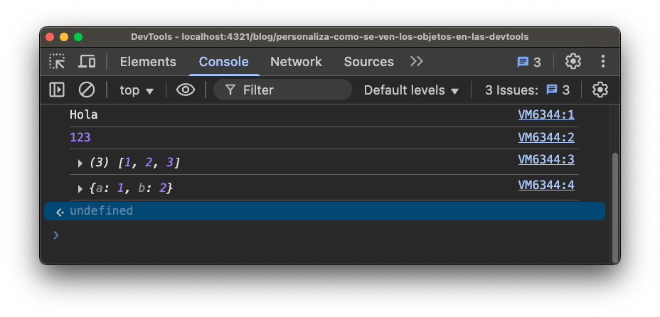
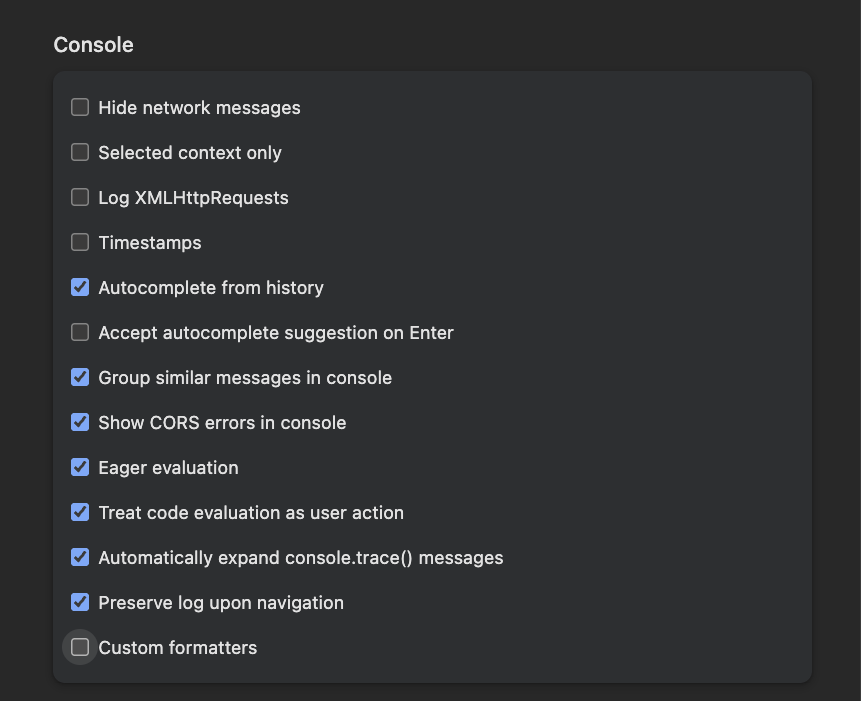
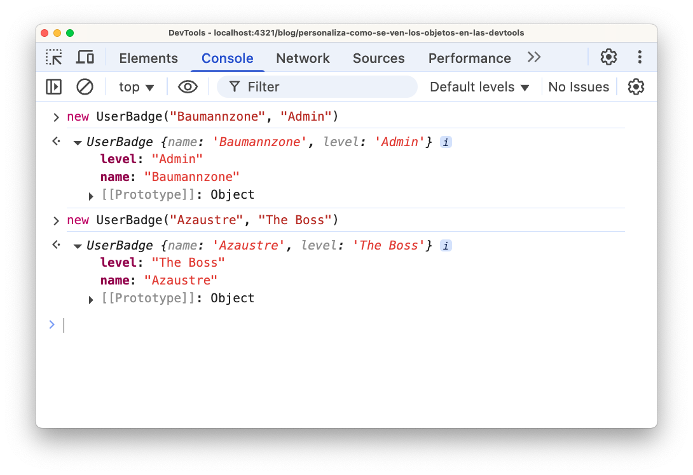
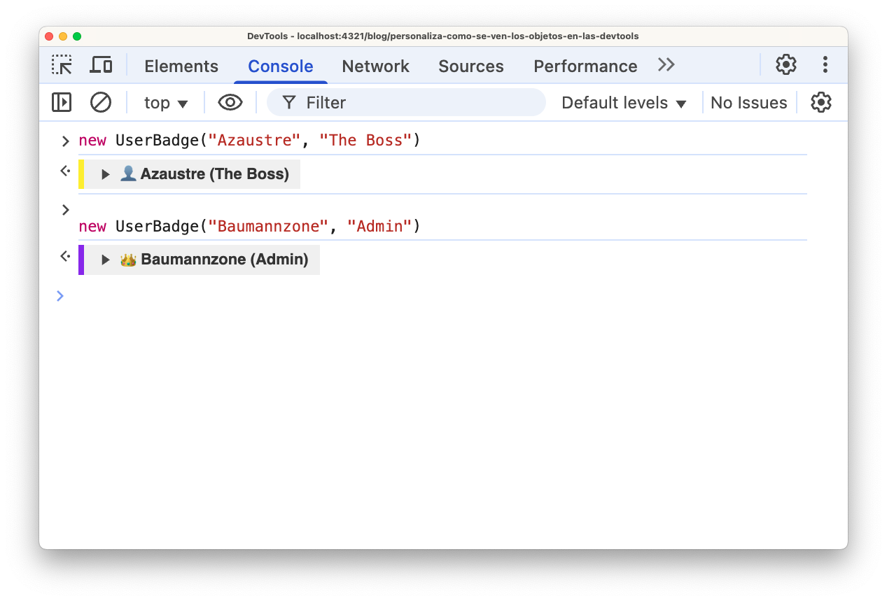
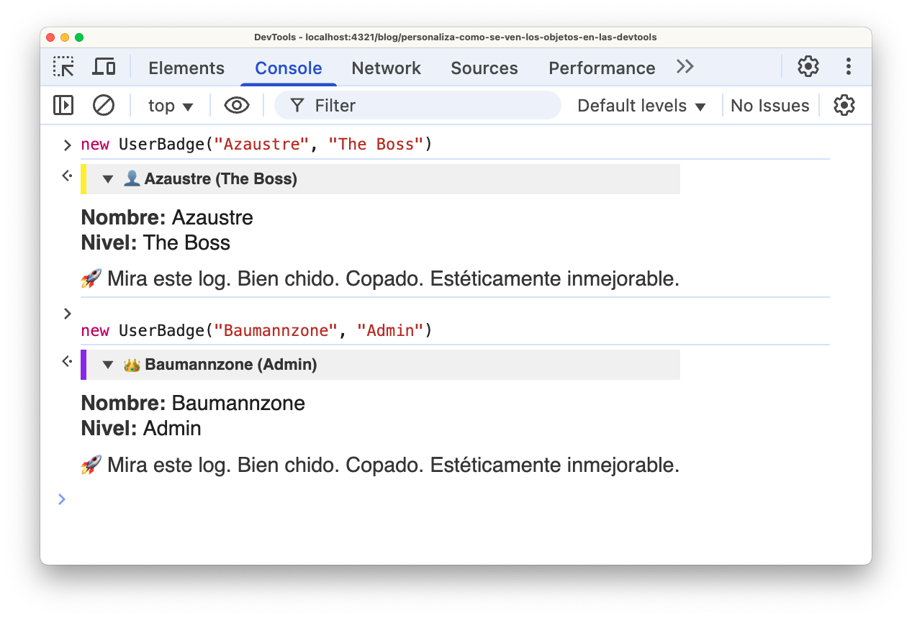

Para cambiar cómo se ve un objeto en la consola de las DevTools, activa los **Custom Object Formatters** en los ajustes del navegador y añade un formateador al array global `window.devtoolsFormatters`. Cada formateador es un objeto con una función `header` que devuelve la vista del objeto en formato JsonML. Funciona en Chrome, Edge y Firefox.

Los objetos aparecen en muchos lugares en las **Developer Tools**. Más comúnmente en la herramienta **Console**, pero también aparecen cuando estás en modo detective dentro de **Sources** (o Debugger) cuando depuras código JavaScript.

Las DevTools de cada navegador son las que deciden cómo aparecen estos objetos en la interfaz de usuario. Por ejemplo, las cadenas de texto y los números tienen diferentes colores, los arrays tienen una pequeña vista previa de los elementos y un icono que te permite expandirlos para ver la lista completa de elementos, etc.

Veamos algunos ejemplos de cómo se ven diferentes tipos de datos en la consola:



Pero... ¿y si tú quieres algo más? Algo que diga: "_este objeto es el MVP de mi aplicación_".


Bienvenido a los `Custom Object Formatters`, una función no tan conocida que te deja personalizar cómo se muestran tus objetos en las DevTools. Puedes hacer que tus objetos aparezcan con estilos personalizados, colores, e incluso con emojis.

## Cómo activar los Custom Object Formatters

Para poder hacer esto, primero necesitas activar el soporte para esta característica en el navegador. Viene desactivada por defecto:

- **Chrome y Edge**: abre los ajustes de las DevTools (el icono del engranaje o `F1`) y, en **Preferences** > **Console**, marca **Custom formatters**.
- **Firefox**: en los ajustes de las DevTools, dentro de **Advanced settings**, marca **Enable custom formatters**. El cambio se aplica la próxima vez que abras las DevTools.



## ¿Cómo se hace la magia?

Los `Custom Object Formatters` no son algo que configures en las DevTools. DevTools no tiene un panel de "personalización de objetos". En lugar de eso, tú defines el formato en el código de tu página, y DevTools lo detecta automáticamente.

### La estructura de un formateador

```javascript
{
  header: function(obj)   { /* Vista previa del objeto        */ },
  hasBody: function(obj)  { /* ¿Tiene más info para expandir? */ },
  body: function(obj)     { /* Lo que se ve al expandirlo     */ }
}
```

Solo `header` es obligatoria. `hasBody` y `body` solo hacen falta si quieres que el objeto se pueda expandir.

### ¿Qué hace cada una?

- `header`: devuelve la vista previa del objeto en formato JsonML, o `null` si este formateador no sabe mostrarlo.
- `hasBody`: devuelve un booleano que indica a DevTools si el objeto se puede expandir para mostrar más información.
- `body`: devuelve lo que se ve cuando el objeto está expandido, también en formato JsonML.

Lo de devolver `null` es importante. DevTools prueba los formateadores de `devtoolsFormatters` en orden: si `header` devuelve `null`, pasa al siguiente, y si ninguno lo maneja, muestra el objeto como siempre.

### El formato JsonML

Todo esto se basa en [JsonML](http://www.jsonml.org/), una forma (muy extraña) de escribir HTML con arrays. Cada elemento es un array con la etiqueta, un objeto de atributos y sus hijos:

```javascript
["span", { style: "color: red;" }, "Hola"];
// Equivale a <span style="color: red;">Hola</span>
```

No vale cualquier HTML. Solo se permiten las etiquetas `span`, `div`, `ol`, `ul`, `li`, `table`, `tr` y `td`, y el único atributo es `style`. Tampoco se permiten todas las propiedades de CSS: por ejemplo, `background-image` solo acepta URLs `data:`, y `position` solo `static` o `relative`.

## Ejemplo práctico

Digamos que tienes una clase `UserBadge` que representa a un usuario con su nombre y nivel:

```javascript
class UserBadge {
  constructor(name, level) {
    this.name = name;
    this.level = level;
  }
}
```

Y quieres crear un nuevo usuario:

```javascript
const admin = new UserBadge("Baumannzone", "Admin");
```

Si lo imprimimos en la consola, se verá así _(de triste)_:



Ahora quieres que al hacer `console.log(admin)` en las DevTools, no salga esa cosa gris y roja deprimente, sino algo que tenga estilo. Entonces haces tu formateador:

```javascript
const userBadgeFormatter = {
  header: function (object) {
    if (!(object instanceof UserBadge)) return null;

    return [
      "div",
      {
        style: `
          background-color: #f0f0f0;
          color: #333;
          border-left: 4px solid ${
            object.level === "Admin" ? "#7c3aed" : "#ffeb00"
          };
          padding: 0.25rem 0.5rem;
          font-weight: bold;
          font-family: sans-serif;
        `,
      },
      `${object.level === "Admin" ? "👑" : "👤"} ${object.name} (${
        object.level
      })`,
    ];
  },

  hasBody: function (object) {
    return object instanceof UserBadge;
  },

  body: function (object) {
    return [
      "div",
      {
        style:
          "margin-top: 0.5rem; font-family: sans-serif; font-size: 0.9rem;",
      },
      [
        "div",
        {},
        ["span", { style: "font-weight: bold; color: #333;" }, "Nombre: "],
        ["span", {}, object.name],
      ],
      [
        "div",
        {},
        ["span", { style: "font-weight: bold; color: #333;" }, "Nivel: "],
        ["span", {}, object.level],
      ],
      [
        "div",
        { style: "margin-top: 0.5rem;" },
        [
          "span",
          { style: "opacity: 0.9;" },
          "🚀 Mira este log. Bien chido. Copado. Estéticamente inmejorable.",
        ],
      ],
    ];
  },
};
```

Fíjate en la primera línea de `header`: si el objeto no es un `UserBadge`, devuelve `null` para que el resto de objetos se vean como siempre.

Por último, añade tu formateador al array global `window.devtoolsFormatters`:

```javascript
(window.devtoolsFormatters ??= []).push(userBadgeFormatter);
```

Uso `push` en vez de `window.devtoolsFormatters = [userBadgeFormatter]` porque algunas librerías registran sus propios formateadores (Vue 3, por ejemplo, lo hace en modo desarrollo). Si asignas un array nuevo, te cargas los suyos.

Eso es todo, no necesitas hacer nada más. Ahora, cada vez que los objetos `UserBadge` se muestren en las DevTools (por ejemplo, cuando uses `console.log(admin)`), se mostrarán usando el formateador personalizado que has definido.

## Resultado

En estas imágenes puedes ver el resultado de usar el formateador personalizado, primero sin expandir el objeto y luego expandido:




## Mostrar objetos dentro de tu formato

Dentro del JsonML puedes incluir otro objeto con la plantilla especial `["object", { object: valor }]`. DevTools lo pinta con su formato normal (o con otro formateador, si lo hay) y se puede expandir. Por ejemplo, para mostrar el objeto completo en el `body`:

```javascript
body: function (object) {
  return ["div", {}, ["object", { object: { ...object } }]];
},
```

Uso una copia (`{ ...object }`) porque, si pasas el mismo `UserBadge`, DevTools le volvería a aplicar tu formateador y verías otra vez la misma cabecera en lugar de sus propiedades.

## Conclusión

Personalizar cómo se muestran tus objetos en las DevTools no va a resolver todos tus bugs, pero al menos lo harás con algo de dignidad visual.

Los **Custom Object Formatters** no son solo una curiosidad. Frameworks como Vue 3 los usan para que sus objetos reactivos se lean bien en la consola, y tú puedes hacer lo mismo con los objetos de tu aplicación. Mejoran tu productividad, tu comprensión de la aplicación y, por qué no, tu autoestima como developer.

Si te gustan estos trucos de las DevTools, mira también [cómo saber qué elemento tiene el foco en tiempo real](/blog/como-detectar-el-elemento-con-el-foco-en-tiempo-real/).

## Fuentes

- [Custom Formatters](https://firefox-source-docs.mozilla.org/devtools-user/custom_formatters/index.html), en la documentación de las DevTools de Firefox.
- [Custom Chrome DevTools object formatters](https://www.mattzeunert.com/2016/02/19/custom-chrome-devtools-object-formatters.html), de Matt Zeunert.
- [JsonML](http://www.jsonml.org/), el formato en el que se basan.
