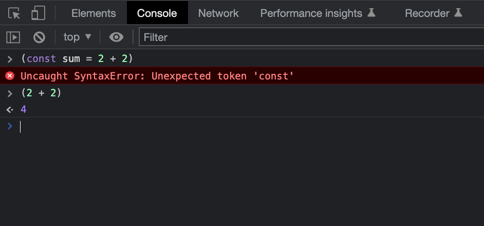

Una IIFE (_Immediately Invoked Function Expression_) es una función de JavaScript que se ejecuta en el mismo momento en que se define: `(function () { ... })()`. Se usa para crear un ámbito propio, de forma que sus variables y funciones no acaben en el _scope_ global ni choquen con las de otros archivos.

Durante años fue el patrón estándar para organizar código en JavaScript: librerías como jQuery envolvían todo su código en una IIFE, y es lo que siguen generando muchos _bundlers_ por debajo. Hoy los módulos cubren buena parte de ese trabajo, pero las IIFE siguen apareciendo en código antiguo, en scripts sueltos y cada vez que necesitas usar `await` fuera de una función.

En este artículo verás cómo se escriben, por qué llevan esos paréntesis, para qué sirven y cuándo ya no hacen falta. Para entenderlo, empecemos por el problema que resuelven.

## El problema: nombres que chocan en el scope global

Cuando estás desarrollando con JavaScript, existe la posibilidad de que haya una función o variable con el mismo nombre en otros archivos JavaScript escritos por otros desarrolladores o en librerías de terceros. Si incluyes estos archivos en una sola página web con etiquetas `<script>` clásicas, todos comparten el mismo _scope global_.

Tomemos como ejemplo dos archivos JavaScript que contienen una variable y una función con el mismo nombre:

```js
// file-1.js
var user = "Baumann";
function sayHello() {
  console.log(`Hello, ${user}!`);
}
```

```js
// file-2.js
var user = "@baumannzone";
function sayHello() {
  console.log(`Hello, ${user}!`);
}
```

¿Qué pasa si incluimos ambos archivos en una sola página web y después llamamos a `sayHello()`?

```html
<!-- index.html -->
<!DOCTYPE html>
<html lang="es">
  <head>
    <meta charset="UTF-8" />
    <title>IIFE - Baumannzone.dev</title>
  </head>
  <body>
    <script src="file-1.js"></script>
    <script src="file-2.js"></script>
    <script>
      sayHello();
    </script>
  </body>
</html>
```

Si abres la consola del navegador verás que el resultado es el siguiente:

```bash
> Hello, @baumannzone!
```

Esto sucede porque la variable `user` y la función `sayHello` de `file-2.js` sobrescriben a las de `file-1.js` en el ámbito global. JavaScript no avisa: se queda con la última definición.

Con `const` o `let` el resultado es distinto, pero no mejor: el segundo archivo lanza un `SyntaxError` (`Identifier 'user' has already been declared`) y no se ejecuta ninguna de sus líneas.

Las IIFE solucionan este problema ya que tienen su propio scope y evitan que las variables y funciones sean globales.

## ¿Qué es una IIFE?

Una **IIFE** o **Immediately Invoked Function Expression** es una expresión de función que se ejecuta inmediatamente después de ser creada. Es un patrón muy utilizado en JavaScript. También se las conoce como _funciones autoejecutables_, _funciones autoinvocadas_ o _funciones anónimas autoejecutables_. El nombre IIFE lo propuso Ben Alman en 2010.

La principal característica de este patrón es que la función se invoca en la misma expresión en la que se define, y no se puede volver a llamar después.

```js
(function () {
  const name = "Baumann";
  console.log(`Hello, ${name}!`);
})();

// Llama a la función inmediatamente después de definirla
// con los paréntesis del final.
```

Cuando declaras una variable dentro de una función sólo podrás acceder a su valor dentro de esa función, independientemente de si la función es autoejecutable o no. Esto es una característica de JavaScript que se conoce como _scope_, alcance o ámbito.

## ¿Cómo se escribe una IIFE?

Los paréntesis `()` juegan un papel importante en el patrón IIFE. En JavaScript, los paréntesis no pueden contener declaraciones, solo expresiones.

```js
// Inválido
(const sum = 2 + 2);
(const name = '@baumannzone');

// Válido
(2 + 2);
(!false);
(alert('baumannzone.dev'));
```



Una IIFE se compone de dos partes:

1. Una expresión de función anónima envuelta entre paréntesis (el operador de agrupación).
2. Los paréntesis del final, `()`, que invocan esa función inmediatamente.

Para crear una IIFE, lo primero que vas a hacer es crear una expresión de función, como sueles hacerlo normalmente:

```js
const myFunction = function () {
  console.log("Hello, Developer! 👋");
};
```

Luego, envuelves la expresión de función en paréntesis. Los paréntesis no pueden contener declaraciones, solo expresiones. Por lo tanto, tienes que borrar la parte de la declaración:

```js
(function () {
  console.log("Hello, Developer! 👋");
});
```

Por último debes agregar el operador paréntesis `()` al final de la expresión de función:

```js
(function () {
  console.log("Hello, Developer! 👋");
})();
```

Ahora ya puedes escribir todas las funciones y variables dentro de una IIFE sin preocuparte por contaminar el ámbito global o entrar en conflicto con otro código de JavaScript que tenga funciones o variables con el mismo nombre.

Además se resuelve el problema que teníamos antes con los archivos `file-1.js` y `file-2.js`, como verás en el apartado sobre conflictos de nombres.

## Ventajas de usar IIFE en JavaScript

Estas son algunas de las ventajas y usos comunes que tienen las IIFE en JavaScript:

### Proteger el alcance de variables y funciones

Las IIFE se utilizan a menudo en JavaScript para crear un ámbito de ejecución aislado y evitar la contaminación del scope global. Al crear una IIFE y definir variables y funciones dentro de ella, esas variables y funciones solo estarán disponibles dentro de la función (como en cualquier otra función normal) y no se agregarán al scope global.

```js
(function () {
  const name = "Baumann";
  function sayHello() {
    console.log(`Hello, ${name}!`);
  }
  sayHello();
})();

sayHello(); // ✕ ReferenceError: sayHello is not defined
```

### Evitar conflictos de nombres

Sirven para evitar que las variables se sobrescriban o se modifiquen por accidente. Sobre todo si tienes varias bibliotecas o fragmentos de código que usan el mismo nombre para sus variables o funciones.

```js
(function () {
  const name = "Baumann";
  function sayHello() {
    console.log(`Hello, ${name}!`);
  }
  sayHello();
})();

(function () {
  const name = "@baumannzone";
  function sayHello() {
    console.log(`Hello, ${name}!`);
  }
  sayHello();
})();

// Hello, Baumann!
// Hello, @baumannzone!
```

### Mejorar la organización del código

Al agrupar código relacionado dentro de una IIFE, puedes mejorar la legibilidad y mantenibilidad de tu código.

### Usar `await` donde no hay _top-level await_

Hoy es el uso más habitual. En un script clásico o en un módulo CommonJS no puedes usar `await` fuera de una función, así que se envuelve el código en una IIFE asíncrona:

```js
(async () => {
  const response = await fetch("/api/user");
  const user = await response.json();
  console.log(user);
})();
```

¿Conoces alguna otra ventaja de usar IIFE en JavaScript? ¡Cuéntamelo en los comentarios! 👇

## ¿Siguen haciendo falta las IIFE hoy?

Menos que antes. Las IIFE nacieron cuando `var` y las funciones eran la única forma de crear un ámbito. Desde ES2015 el propio lenguaje cubre casi todos esos casos:

| Necesidad                         | Antes | Hoy                                                 |
| :-------------------------------- | :---- | :-------------------------------------------------- |
| Que un archivo no ensucie el scope global | IIFE  | Módulos ES (`<script type="module">`, `import`/`export`) |
| Una variable temporal con ámbito limitado | IIFE  | `let` o `const` dentro de un bloque `{ }`           |
| Estado privado                    | IIFE  | Módulos o campos privados de clase (`#campo`)       |
| `await` fuera de una función      | IIFE asíncrona | _Top-level await_ en módulos ES            |

Cada módulo ES tiene su propio ámbito, así que el problema de `file-1.js` y `file-2.js` desaparece con solo cargarlos como módulos. Aun así, te las seguirás encontrando en scripts clásicos, en código antiguo y en el resultado que generan muchos _bundlers_.

## ¿Cuándo no usar IIFE en JavaScript?

Las IIFE son útiles en diversos casos, pero hay algunas situaciones en las que es recomendable evitar su uso:

- **Cuando no se necesita aislar el ámbito de las variables**: Si la función no utiliza variables que puedan entrar en conflicto con otras del mismo nombre, o si no se requiere crear un ámbito privado para evitar el acceso a ciertas variables, entonces no tiene sentido utilizar una IIFE.

- **Cuando se necesita reutilizar la función**: Si la intención es utilizar la función en más de un lugar del código, es mejor definirla de manera explícita y luego invocarla cuando sea necesario, en lugar de utilizar una IIFE.

- **Cuando se necesita pasar parámetros a la función**: Aunque es posible pasar parámetros a una IIFE, es más sencillo hacerlo cuando la función está definida de manera explícita.

- **Cuando se quiere crear una función de manera más legible**: Aunque las IIFE son útiles para minimizar el código, pueden dificultar la lectura y entendimiento del mismo, especialmente cuando la función es larga o complicada. En estos casos, es mejor definir la función de manera explícita.

Es importante tener en cuenta que las IIFE son una herramienta más en el arsenal de un programador JavaScript, y deben utilizarse cuando se ajusten a las necesidades del código en cuestión.

## Curiosidades sobre las IIFE

Esta información es interesante para profundizar en el tema, pero no es necesaria para entender el concepto de IIFE en JavaScript.

Las IIFE soportan parámetros y retornos:

```js
(function (name) {
  console.log(`Hello, ${name}!`);
})("Baumann");

// Hello, Baumann!
```

```js
const result = (function (a, b) {
  return a + b;
})(1, 2);

console.log(result); // 3
```

### Formas alternativas de escribir una IIFE

Las IIFE también pueden ser escritas de la siguiente manera:

- Las más habituales:

<!-- prettier-ignore -->
```js
// Paréntesis de invocación fuera
(function () {
  console.log("Hello, Developer! 👋");
})();

// Paréntesis de invocación dentro (la que recomendaba Crockford)
(function () {
  console.log("Hello, Developer! 👋");
}());

// Arrow functions
(() => {
  console.log("Hello, Developer! 👋");
})();

// Operador negación
!(function () {
  console.log("Hello, Developer! 👋");
})();
```

- Si no te importa el valor de retorno

```js
~(function () {})(); // -1
+(function () {})(); // NaN
-(function () {})(); // NaN
```

- Otras formas menos habituales y más rebuscadas:

```js
// Operador void
void (function () {})();

// Operador new
new (function () {})();

true && (function () {})();
42, (function () {})();

// etc
```

Podríamos seguir con más formas de escribir una IIFE, pero con estas ya tienes suficiente para entender el concepto. Todas funcionan por el mismo motivo: si una sentencia empieza por la palabra `function`, JavaScript la interpreta como una declaración, y una declaración no se puede invocar al vuelo. Cualquier cosa que ponga esa función en posición de expresión (unos paréntesis, un operador delante) la convierte en una expresión de función, que sí se puede llamar.

La mayoría de formas alternativas no las vas a usar, ya que son formas de escribir código bastante confusas, pero usadas a menudo cuando haces **code golfing** o para minificar código.

## ¿Quieres seguir aprendiendo?

Ahora que sabes qué son las expresiones de función inmediatamente invocadas en JavaScript, es momento de seguir aprendiendo. Sígueme en [Instagram](https://www.instagram.com/baumannzone/) y comparte este artículo para que más personas puedan aprender JavaScript.

¿Conocías las IIFE? ¿Las has usado alguna vez? ¡Cuéntamelo en los comentarios! 👇

¡Happy coding!

## Fuentes

- [IIFE: expresión de función ejecutada inmediatamente](https://developer.mozilla.org/es/docs/Glossary/IIFE), en el glosario de MDN.
- [Operador de agrupación](https://developer.mozilla.org/es/docs/Web/JavaScript/Reference/Operators/Grouping) y [expresión `function`](https://developer.mozilla.org/es/docs/Web/JavaScript/Reference/Operators/function), en MDN.
- [Módulos JavaScript](https://developer.mozilla.org/es/docs/Web/JavaScript/Guide/Modules), la guía de MDN sobre el ámbito propio de cada módulo.
- [Immediately-Invoked Function Expression (IIFE)](https://benalman.com/news/2010/11/immediately-invoked-function-expression/), el artículo de Ben Alman que le dio nombre al patrón (en inglés).
