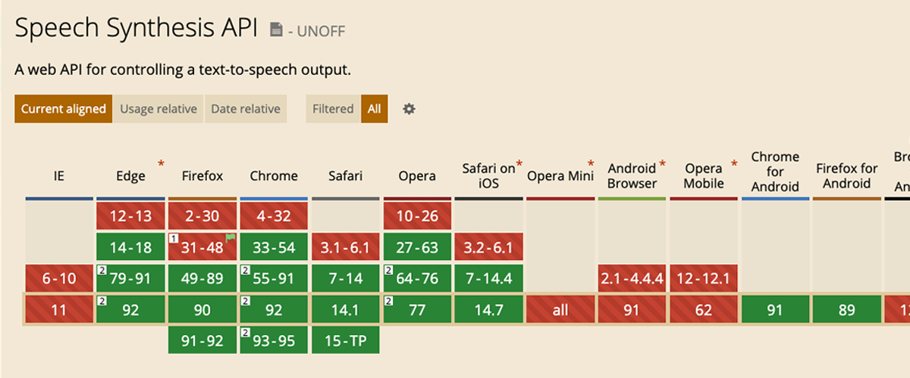
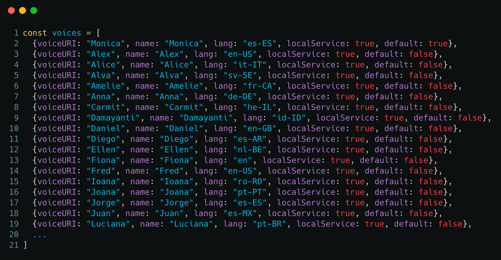

Para que el navegador hable con JavaScript basta con una línea: `speechSynthesis.speak(new SpeechSynthesisUtterance("Hola"))`. Es la parte de síntesis de voz de la **Web Speech API**, viene de serie en Chrome, Firefox y Safari, y no necesita ninguna librería.

La Web Speech API se divide en dos partes:

- **SpeechSynthesis**: convierte texto en voz (TTS).
- **SpeechRecognition**: convierte voz en texto (STT).

En este artículo nos centramos en **SpeechSynthesis**, la parte que hace que el navegador hable.

## Compatibilidad de la Web Speech API

La mayoría de navegadores modernos ya implementan esta API. No me gusta hablar como si estuviéramos en 2005, pero conviene recordarlo: asegúrate de que tu navegador la soporta.

¿Usas Chrome, Firefox o Safari actualizados? Debería funcionar.
¿Estás en móvil? Ahí puede haber más limitaciones.

Así se ve el soporte en Can I Use:



A primera vista, el soporte parece bastante bueno, pero tiene truco.
El soporte _completo_ está más limitado de lo que parece.

Algunas funcionalidades, como elegir la **voz**, ajustar el **tono** o la **velocidad**, pueden variar según navegador, sistema operativo y dispositivo.

Además, los navegadores no dejan hablar a una página sin que hayas interactuado antes con ella. Si `speak()` no suena, haz clic en la página y vuelve a intentarlo. En una web real, lánzalo desde un evento de usuario, como un clic en un botón.

## Cómo hacer que el navegador hable 🗣

Todos los ejemplos están probados en Chrome.

```javascript
// Lo primero es obtener el sintetizador de voz
const synth = window.speechSynthesis;

// Creamos un objeto con el texto que queremos que diga
const text = "Soy Jorge Baumann, @baumannzone en Instagram";
const utterThis = new SpeechSynthesisUtterance(text);

// Le decimos al navegador que hable
synth.speak(utterThis);
```

Fácil, ¿verdad?

Ahora te toca a ti: cambia el texto y haz que tu navegador hable.

### Todo en una línea

Pega esto en la consola del navegador y escucha la magia 🎩

```js
window.speechSynthesis.speak(
  new SpeechSynthesisUtterance(
    "¡Hola! Soy Jorge Baumann (@baumannzone en Instagram)",
  ),
);
```

## Cómo cambiar la velocidad y el tono

Hasta ahora has hecho que el navegador hable con los valores por defecto. Vamos a ver cómo ajustar la velocidad y el tono.

Por defecto, ambos tienen un valor de `1`, pero puedes modificarlos fácilmente así:

```javascript
const text = "Visita baumannzone.dev para más desarrollo web pro";

const synth = window.speechSynthesis;
const utterThis = new SpeechSynthesisUtterance(text);

// Cambiar el tono (por defecto es 1)
utterThis.pitch = 1.5;

// Cambiar la velocidad (por defecto es 1)
utterThis.rate = 1.5;

synth.speak(utterThis);
```

Una vez más, te toca a ti. Juega con los valores de `pitch` y `rate` para ver cómo cambia la voz.

Y si quieres que se calle antes de terminar, `synth.cancel()` corta la frase y vacía la cola.

### Valores permitidos de `pitch`, `rate` y `volume`

Si has tenido problemas al cambiar la velocidad o el tono, probablemente usaste valores fuera del rango permitido. Por ejemplo, un tono (`pitch`) de `3` no funcionará correctamente.

Estos son los rangos que marca la especificación:

| Propiedad | Mínimo | Máximo | Por defecto |
| --------- | ------ | ------ | ----------- |
| `pitch`   | `0`    | `2`    | `1`         |
| `rate`    | `0.1`  | `10`   | `1`         |
| `volume`  | `0`    | `1`    | `1`         |

En `pitch`, `0` es lo más grave y `2` lo más agudo.

## Cómo cambiar la voz con `getVoices()`

Hasta ahora hemos usado la voz por defecto del sistema. Vamos a elegir una voz concreta.

El primer paso es obtener el listado de voces con `getVoices()`. Si hay una voz en español, la usamos; si no, tiramos de la primera disponible con el operador [`??`](/blog/doble-signo-de-interrogacion-en-javascript/).

```javascript
const synth = window.speechSynthesis;
const text = "Puedes seguirme en Bluesky: @baumannzone";

function speakInSpanish() {
  const voices = synth.getVoices();
  const utterThis = new SpeechSynthesisUtterance(text);

  utterThis.voice =
    voices.find((voice) => voice.lang.startsWith("es")) ?? voices[0];
  synth.speak(utterThis);
}

if (synth.getVoices().length) {
  speakInSpanish();
} else {
  synth.addEventListener("voiceschanged", speakInSpanish, { once: true });
}
```

### Ojo con esto

En algunos navegadores, como Chrome, la lista de voces se carga de forma **asíncrona**, así que `getVoices()` puede devolverte un array vacío si la llamas demasiado pronto. En otros ya está disponible desde el principio y el evento `voiceschanged` no llega a dispararse. Por eso el código comprueba primero si hay voces y solo espera al evento cuando no las hay.

Y aquí tienes un listado de voces disponibles en Chrome en un MacBook Pro cuando publiqué este artículo originalmente (2018):



## Conclusión

La Web Speech API no es perfecta, pero es una API nativa muy útil para prototipos, features de accesibilidad y experiencias más interactivas.

Si vas a usarla en producción, valida soporte por navegador, prueba en móvil y controla bien los fallbacks. Con eso, puedes sacar mucho valor sin meter dependencias externas.

Si te gustan estas APIs del navegador que casi nadie usa, mira también cómo [evitar que la pantalla se duerma con la Screen Wake Lock API](/blog/evita-que-la-pantalla-se-duerma-con-javascript-domina-la-screen-wake-lock-api/).

## Fuentes

- [Web Speech API](https://developer.mozilla.org/es/docs/Web/API/Web_Speech_API), la guía de MDN con las dos partes de la API.
- [SpeechSynthesisUtterance](https://developer.mozilla.org/en-US/docs/Web/API/SpeechSynthesisUtterance) y [SpeechSynthesis.getVoices()](https://developer.mozilla.org/en-US/docs/Web/API/SpeechSynthesis/getVoices), en MDN.
- [Web Speech API](https://webaudio.github.io/web-speech-api/), la especificación con los rangos de `pitch`, `rate` y `volume`.
- [Speech Synthesis API](https://caniuse.com/speech-synthesis), la compatibilidad por navegador en Can I Use.
