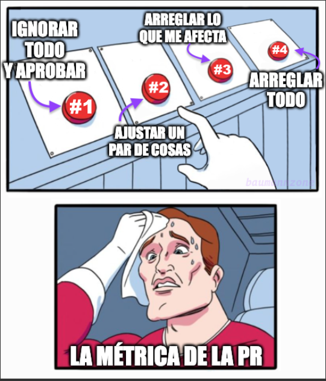
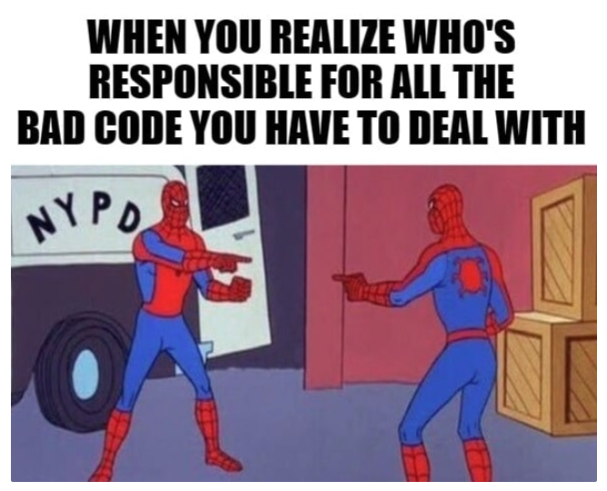

La "métrica de la PR" mide qué haces cuando, al revisar o abrir una **pull request** (PR), te encuentras código que no está bien: ignorarlo y aprobar, hacer algún ajuste, arreglar solo lo que te afecta o mejorarlo aunque no te toque. Según en cuál de esos cuatro grupos estés, tu impacto en el equipo es muy distinto.

Cuando trabajamos en repositorios compartidos, siempre llega ese momento: revisar código ajeno antes de aprobar una PR, o tocar código que escribió otra persona para terminar tu tarea.

En esos momentos se nota mucho cómo reaccionamos cada uno. No suele haber alguien específico encargado de mejorar continuamente el código, así que cada persona decide cómo actuar.

## Revisar una PR no es lo mismo que abrirla

Antes de ver los grupos, una aclaración. La métrica sirve para los dos lados de una PR, pero no se actúa igual en cada uno:

- **Si revisas**, tu herramienta son los comentarios. Señalas lo que ves y propones mejoras, pero no reescribes la PR de otra persona.
- **Si eres quien abre la PR**, puedes mejorar directamente el código que tocas para tu tarea.

En los dos casos, la pregunta es la misma: ¿qué haces con lo que no está bien?

## Los cuatro grupos de la métrica de la PR

Según mi experiencia, podemos distinguir cuatro tipos de personas según cómo gestionan esta situación.

### Grupo 1 🙄: ignorar todo y aprobar

Revisan la PR por encima, la aprueban si cumple con lo más básico y pasan a otra tarea, ignorando pequeños problemas o posibles mejoras. Cumplen sus objetivos, pero la deuda técnica se acumula y en el futuro alguien tendrá que resolverla.

Por ejemplo: ves una función de 200 líneas sin tests, piensas "esto no es mío" y le das a **Approve**.

### Grupo 2 🫥: ajustar un par de cosas

Revisan el código, aprueban la PR y de vez en cuando hacen pequeños ajustes o sugerencias para evitar que el código empeore. Se aseguran de que el sistema no quede peor de lo que lo encontraron.

Por ejemplo: dejas un comentario para renombrar una variable que no se entiende, o lo cambias tú si la PR es tuya.

### Grupo 3 🙃: arreglar lo que me afecta

Aprovechan la PR para arreglar problemas técnicos, pero solo cuando bloquean o afectan directamente a su propio trabajo o a sus próximas tareas.

Por ejemplo: refactorizas el módulo de pagos porque mañana te toca añadirle una funcionalidad, pero el de facturación, igual de mal, se queda como está.

### Grupo 4 🤩: arreglar todo

Usan cada PR para mejorar la calidad global del código, refactorizando o proponiendo mejoras aunque no sean necesarias para su trabajo a corto plazo o no les afecten directamente.

Por ejemplo: añades el test que faltaba, abres un ticket con la deuda técnica que has visto y propones una mejora en el canal del equipo para que otra persona no se tropiece con lo mismo.

## ¿Qué impacto tienes como developer?

La calidad de nuestro trabajo no solo se mide en el código que escribimos, sino en nuestra capacidad de ver más allá de las tareas inmediatas. La métrica de la PR es una forma de autoevaluar nuestro impacto real en el equipo y el proyecto:

- **Grupo 1** (por debajo de las expectativas): cumple únicamente con sus tareas inmediatas y deja que la deuda técnica se acumule.
- **Grupo 2** (cumple expectativas): hace sus tareas asegurándose de no empeorar el código existente.
- **Grupo 3** (cumple expectativas): mejora el código, pero solo cuando le afecta directamente.
- **Grupo 4** (supera expectativas): busca activamente mejorar el sistema para beneficio colectivo, aunque no sea su responsabilidad ni le beneficie de inmediato.

La idea no es nueva. Es la "regla del boy scout" que popularizó Robert C. Martin: deja el código un poco mejor de lo que lo encontraste. Y es también el criterio que usa Google en sus guías de revisión de código: aprobar una PR cuando mejora la salud general del código, aunque no sea perfecta.

## Cuidado con el grupo 4

Querer arreglarlo todo tiene un riesgo: convertir una PR de 20 líneas en una de 800. Una PR enorme es más difícil de revisar, tarda más en aprobarse y es más probable que esconda un bug.

Para estar en el grupo 4 sin bloquear a nadie:

- **Las mejoras pequeñas**, como renombrar una variable local, pueden ir en la misma PR.
- **Los refactors grandes van en una PR aparte**, separados de la funcionalidad o del bug que estás arreglando.
- **Si no te da tiempo**, abre un ticket o deja un comentario. Dejar constancia del problema también es mejorar el sistema.

## Cómo subir de grupo

No hace falta pasar del grupo 1 al 4 de golpe. Algunas ideas para dar el siguiente paso:

1. **Haz una sugerencia en cada revisión.** Aunque sea pequeña. Con el prefijo "Nit:" dejas claro que no bloquea la PR.
2. **Deja el código que tocas un poco mejor.** Un nombre más claro, un test más o un comentario que explique algo raro.
3. **Apunta la deuda técnica que veas.** Un ticket con contexto vale más que un "esto está fatal" en el chat.
4. **Habla de ello en la retro.** Si todo el equipo ve los mismos problemas, es un buen tema para tu próxima [retrospectiva](/blog/ejercicio-para-retrospectivas-agile/).

## Conclusión

Escribir código es solo una parte del trabajo. Lo que haces con el código de los demás, y con el tuyo cuando lo vuelves a tocar, dice mucho de tu impacto en el equipo.

Ahora pregúntate con sinceridad:

> ¿En qué grupo encajo yo?

👇 Déjame un comentario y cuéntame con qué grupo te identificas.

## Fuentes

- [The Boy Scout Rule](https://www.oreilly.com/library/view/97-things-every/9780596809515/ch08.html), de Robert C. Martin, en _97 Things Every Programmer Should Know_.
- [The Standard of Code Review](https://google.github.io/eng-practices/review/reviewer/standard.html), en las guías de revisión de código de Google.
- [Small CLs](https://google.github.io/eng-practices/review/developer/small-cls.html), sobre por qué separar los refactors de los cambios funcionales.
