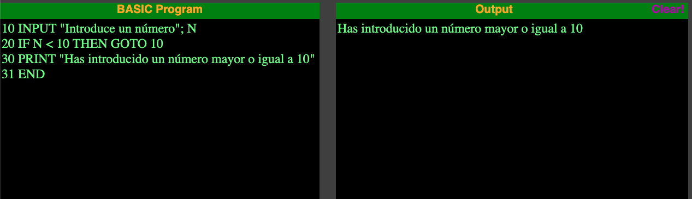
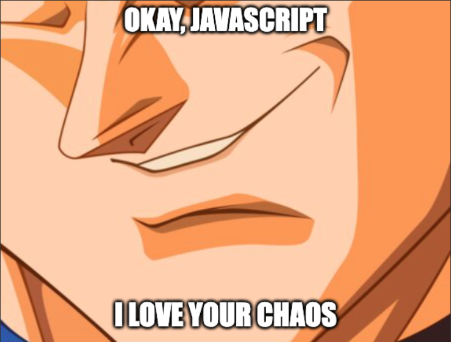

En JavaScript puedes salir de dos bucles anidados a la vez poniéndole una etiqueta al bucle exterior y usando `break etiqueta`. Las etiquetas (_labels_) son identificadores seguidos de dos puntos (`:`) que se colocan delante de un bucle o de un bloque de código, y sirven para decirle a `break` y a `continue` a qué nivel se refieren.

## TL;DR


Su principal función es proporcionar un punto de referencia para las instrucciones `break` y `continue`, permitiendo un control más preciso sobre el flujo de ejecución en estructuras anidadas.

| Sentencia           | Qué hace                                             | Dónde se puede usar                      |
| :------------------ | :--------------------------------------------------- | :--------------------------------------- |
| `break`             | Sale del bucle (o `switch`) más cercano              | Bucles y `switch`                        |
| `break etiqueta`    | Sale de la sentencia que lleva esa etiqueta          | Cualquier sentencia etiquetada           |
| `continue`          | Salta a la siguiente iteración del bucle más cercano | Bucles                                   |
| `continue etiqueta` | Salta a la siguiente iteración del bucle etiquetado  | Solo si la etiqueta está en un bucle     |

## Ejemplo con bucles anidados

En JavaScript, las etiquetas (`label`) son especialmente útiles en bucles anidados cuando quieres controlar exactamente desde qué nivel quieres salir (`break`) o continuar (`continue`). Aquí tienes un ejemplo claro:

```javascript
externo: for (let i = 1; i <= 3; i++) {
  interno: for (let j = 1; j <= 3; j++) {
    if (i * j > 5) {
      break externo; // => Sale completamente de ambos bucles
    }
    console.log(`${i} x ${j} = ${i * j}`);
  }
}

// 1 x 1 = 1
// 1 x 2 = 2
// 1 x 3 = 3
// 2 x 1 = 2
// 2 x 2 = 4
```

En este ejemplo, la etiqueta `externo` permite salir de ambos bucles cuando la multiplicación de `i` y `j` supera el valor `5`. Sin la etiqueta, solo abandonaría el bucle `interno` y seguiría con `i = 3`.

Con `continue` pasa lo mismo, pero en vez de salir salta a la siguiente vuelta del bucle etiquetado:

```javascript
filas: for (let i = 1; i <= 3; i++) {
  for (let j = 1; j <= 3; j++) {
    if (j === 2) {
      continue filas; // => Pasa a la siguiente vuelta del bucle exterior
    }
    console.log(`${i} x ${j} = ${i * j}`);
  }
}

// 1 x 1 = 1
// 2 x 1 = 2
// 3 x 1 = 3
```

## Ejemplo con bloques de código

También funcionan con bloques de código (pero no lo hagas):

```javascript
// Esto no es una variable, ni una función, ni tu salvación.
// Es una etiqueta.
bloque: {
  console.log("Inicio del bloque");
  if (true) {
    break bloque; // => Sale del bloque
  }
  console.log("Este mensaje no se mostrará nunca");
}
```

Sí, has leído bien. Puedes ponerle un `label` a un bloque de código y romperlo con `break`. Técnicamente es válido, pero la legibilidad empeora bastante.

Aquí solo vale `break`: `continue` necesita que la etiqueta esté en un bucle, y si no lo está el código ni siquiera llega a ejecutarse porque es un error de sintaxis.

Este mecanismo recuerda inevitablemente a estructuras de control antiguas, como el famoso `GOTO` de **BASIC**:

```basic
10 INPUT "Introduce un número"; N
20 IF N < 10 THEN GOTO 10
30 PRINT "Has introducido un número mayor o igual a 10"
```



<figcaption> Resultado del ejemplo de BASIC ejecutado en un emulador.</figcaption>

Esto funcionaba perfectamente en BASIC por la naturaleza del lenguaje, pero hacerlo hoy en JavaScript sería volver absurdamente 30 años atrás.

La comparación tiene un límite: una etiqueta de JavaScript no es un `GOTO` de verdad. Solo puedes saltar hacia fuera de una sentencia en la que ya estás, nunca a un punto cualquiera del programa, y tampoco puedes cruzar los límites de una función. Por eso un `break etiqueta` no funciona dentro del _callback_ de un `forEach()`.

## ¿Por qué no usar etiquetas?

Aunque es posible y legal usar etiquetas en JavaScript, jamás me he encontrado con la necesidad de usarlas y espero seguir así.

Casi siempre hay una alternativa más legible y mantenible. La más habitual es sacar los bucles a una función y salir con `return`:

```javascript
function buscarPareja(limite) {
  for (let i = 1; i <= 3; i++) {
    for (let j = 1; j <= 3; j++) {
      if (i * j > limite) {
        return [i, j]; // => Sale de ambos bucles y de la función
      }
    }
  }
  return null;
}

buscarPareja(5); // [2, 3]
```

Y si lo que recorres son arrays, métodos como `find()` o `some()` ya se detienen solos en cuanto encuentran lo que buscan.

## Conclusión

Sí, JavaScript tiene su propia versión ligera del _GOTO_: las **sentencias etiquetadas** o labeled statements.

¿Las necesitas? Lo más probable es que no. ¿Vas a usarlas? Espero que tampoco. ¿Mola saber que existen? Sin duda 🤘.

Es una de esas features que te hacen levantar una ceja, sonreír y pensar: "_vale, JavaScript... me encanta tu caos_".



**Recuerda**: úsalas solo si puedes dormir tranquilo sabiendo que alguien tendrá que mantener ese código después. Puede que seas tú.

## Fuentes

- [Sentencia etiquetada (`label`)](https://developer.mozilla.org/es/docs/Web/JavaScript/Reference/Statements/label), en MDN.
- [`break`](https://developer.mozilla.org/es/docs/Web/JavaScript/Reference/Statements/break) y [`continue`](https://developer.mozilla.org/es/docs/Web/JavaScript/Reference/Statements/continue), en MDN.
- [Labelled Statements](https://tc39.es/ecma262/#sec-labelled-statements), la sección de la especificación de ECMAScript que las define.
